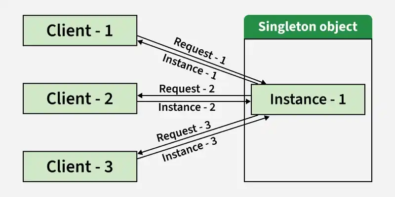

# 1 — Singleton Pattern



> Ensure a class has only one instance, and provide a global point of access to it.

## 💡 The idea

Some objects must exist **exactly once** in a running application. Not "usually once", and
not "once if everybody is careful": a second instance would be a bug.

A normal class can't promise that, because anyone can write `new`. The Singleton pattern makes
the class **responsible for its own instance**, using three ingredients:

1. A **private constructor**, so nobody outside the class can call `new`
2. A **private static field** that holds the one instance
3. A **public static method** (`getInstance()`) that hands that instance to everyone

As in the picture above: every client asks the same class, and every client gets the same
object back.

"One instance" is about **correctness**, not about saving memory. Use Singleton when two
instances would give wrong results, not just because one instance happens to be enough.

## Use case

Your database accepts at most **3 connections**. A `ConnectionPool` class enforces that limit
by counting how many connections are in use.

Then `OrderService` creates a pool with `new ConnectionPool()`. `ReportService` does the same.
Now there are two pools, each one counting to 3 on its own. The application can open 6
connections against a database that allows 3, and neither pool notices.

Other objects with the same "there must be only one" nature:

- **Configuration** loaded once at startup and read everywhere
- **A cache or registry** that the whole application must share
- **An ID or sequence generator**, where two instances would hand out the same number twice
- **Access to a single physical resource**: a printer spooler, a log file, a hardware device

## ❌ Bad example

```java
class ConnectionPool {
    private static final int MAX_CONNECTIONS = 3;
    private int inUse = 0;

    public ConnectionPool() {
        System.out.println("Creating a new ConnectionPool (expensive setup...)");
    }

    public void acquire(String who) {
        if (inUse >= MAX_CONNECTIONS) {
            throw new IllegalStateException("Pool exhausted, " + who + " must wait");
        }
        inUse++;
    }
}

class OrderService {
    private final ConnectionPool pool = new ConnectionPool();   // pool #1
}

class ReportService {
    private final ConnectionPool pool = new ConnectionPool();   // pool #2
}
```

👉 Problems:

- Two pools exist, so the 3-connection limit is enforced twice, separately
- Each pool sees only its own count, so the real total is invisible
- The expensive setup runs once per service instead of once per application
- Nothing stops the next developer from writing `new ConnectionPool()` a third time

## ✅ Good example

```java
class ConnectionPool {
    private static final int MAX_CONNECTIONS = 3;

    // 1. the single instance
    private static final ConnectionPool INSTANCE = new ConnectionPool();

    private int inUse = 0;

    // 2. private constructor: nobody else can call `new`
    private ConnectionPool() {
        System.out.println("Creating the ConnectionPool (expensive setup, runs once)");
    }

    // 3. the one public way to reach it
    public static ConnectionPool getInstance() {
        return INSTANCE;
    }

    public synchronized void acquire(String who) {
        if (inUse >= MAX_CONNECTIONS) {
            throw new IllegalStateException("Pool exhausted, " + who + " must wait");
        }
        inUse++;
    }
}

class OrderService {
    private final ConnectionPool pool = ConnectionPool.getInstance();
}

class ReportService {
    private final ConnectionPool pool = ConnectionPool.getInstance();
}
```

👉 Now a second pool is **impossible**, not just discouraged. Both services share one counter,
so the limit is really enforced.

Notice `synchronized` on `acquire()`. A Singleton is shared by the whole application, so many
threads can call its methods at once. The pattern guarantees one *instance*; keeping that
instance's *state* safe is still your job.

## Eager vs. lazy, and the thread-safety trap

The good example above is an **eager** Singleton: the instance is created when the class is
loaded, even if nobody ever uses it. That is simple and always thread-safe.

Sometimes you want a **lazy** Singleton, created only on first use (for example, when setup is
slow and the object may not be needed). The obvious way to write it is broken:

```java
// ❌ NOT thread-safe
public static ConnectionPool getInstance() {
    if (instance == null) {               // two threads can both see null here...
        instance = new ConnectionPool();  // ...and both create an instance
    }
    return instance;
}
```

It works in every single-threaded test and fails in production, where two threads arrive at
the same moment and you silently get two "singletons".

These are the correct ways to write a Singleton in Java:

| Variant | Lazy? | Thread-safe? | Notes |
|---|---|---|---|
| **Eager** (`static final` field) | No | ✅ | Simplest. The default choice when setup is cheap |
| **Synchronized `getInstance()`** | Yes | ✅ | Correct, but every call takes a lock |
| **Double-checked locking** | Yes | ✅ | Fast, but the field **must** be `volatile` |
| **Holder class** | Yes | ✅ | Lazy and lock-free. The best general-purpose lazy version |
| **Enum** | No | ✅ | Shortest. Also safe against reflection and serialization |

**Double-checked locking** takes the lock only the first time:

```java
private static volatile ConnectionPool instance;

public static ConnectionPool getInstance() {
    if (instance == null) {                         // 1st check, no lock
        synchronized (ConnectionPool.class) {
            if (instance == null) {                 // 2nd check, inside the lock
                instance = new ConnectionPool();
            }
        }
    }
    return instance;
}
```

**Holder class** lets the JVM do the work. The nested class is loaded only when
`getInstance()` is first called, and class loading is thread-safe by definition:

```java
class ConnectionPool {
    private ConnectionPool() { }

    private static class Holder {
        static final ConnectionPool INSTANCE = new ConnectionPool();
    }

    public static ConnectionPool getInstance() {
        return Holder.INSTANCE;
    }
}
```

**Enum** is the shortest form:

```java
enum ConnectionPool {
    INSTANCE;

    public void acquire(String who) { /* ... */ }
}

// usage
ConnectionPool.INSTANCE.acquire("OrderService");
```

## ⚠️ The price of a Singleton

Singleton is the easiest pattern to write and the most misused one. It is global state, and
global state has costs:

- **Hidden dependencies.** `OrderService` uses the pool, but its constructor doesn't say so.
  You only find out by reading the method bodies.
- **Hard to test.** You can't swap the real pool for a fake one, and state left in the
  Singleton by one test leaks into the next.
- **Tight coupling.** Every class that calls `ConnectionPool.getInstance()` is welded to that
  concrete class (a DIP violation).
- **Two jobs in one class.** The class does its real work *and* manages its own lifecycle (an
  SRP smell).

You can keep "exactly one instance" and avoid most of these costs: call `getInstance()` in
**one** place, at application startup, and **pass the instance in** to whoever needs it.

```java
class OrderService {
    private final ConnectionPool pool;

    public OrderService(ConnectionPool pool) {   // the dependency is now visible
        this.pool = pool;
    }
}

// at application startup
ConnectionPool pool = ConnectionPool.getInstance();
OrderService orderService = new OrderService(pool);
ReportService reportService = new ReportService(pool);
```

This is what dependency injection frameworks such as Spring do for you.

## When to use it, and when not to

**Use Singleton when:**

- A second instance would cause wrong behavior (broken limits, duplicate IDs, conflicting
  writes to one resource)
- The object is expensive to build and is truly shared by the whole application

**Don't use Singleton when:**

- You only want an easy way to reach an object from anywhere. That is a global variable
- The class has no state. A class with only static methods (like `Math`) is simpler
- "We only need one right now." Needing one today is not the same as *more than one being a
  bug*
- The object holds data that belongs to a user, a request, or a session

## How to spot that you need it

- The same heavy object (`new Config()`, `new ConnectionPool()`) is created in several classes
- A bug comes from two objects that each believe they are "the" manager of something
- An object is passed through 10 layers only because everybody needs the same one
- A counter, cache, or limit gives wrong results because its state is split across instances

## Real-world mapping

- `Runtime.getRuntime()`, `Desktop.getDesktop()`: classic Singletons in the JDK
- Loggers, application configuration, connection pools (HikariCP's pool is created once and
  shared)
- **Spring beans** are singleton-scoped by default: one instance per container, created by the
  framework and injected, which avoids the costs listed above

A Singleton is "one per JVM class loader". In a system running several servers there is one
instance **per server**, so it can't be used to coordinate between machines.

## Examples

| # | Focus |
|---|-------|
| 01 | Each service creates its own `ConnectionPool`, so the connection limit is broken (problem) |
| 02 | `ConnectionPool` as a Singleton: private constructor, one shared instance, limit enforced (fixed) |

## Build & run

```sh
cd examples/01-bad-example
javac Main.java && java Main
```

```sh
cd examples/02-good-example
javac Main.java && java Main
```

## 🏋️ Practice exercise

Once the examples above make sense, apply Singleton yourself on a fresh scenario:

### [Exercise: Invoice Number Generator →](./exercise/)

Two sales channels each create their own number generator and issue the same invoice number
twice. Fix it with a lazy, thread-safe Singleton.

## Next

### 2. Factory Method *(coming soon)*

Back to [Creational Patterns](../README.md).
