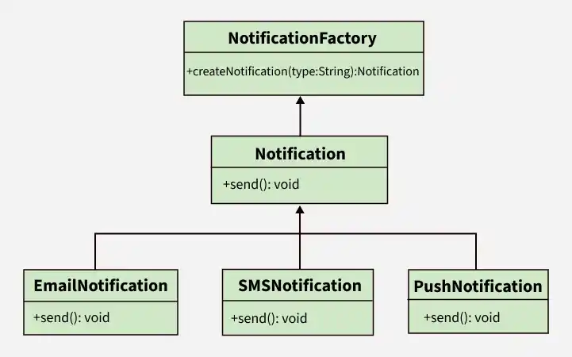

# 2 — Factory Pattern (Simple Factory & Factory Method)



> Define an interface for creating an object, but let subclasses decide which class to
> instantiate.

## 💡 The idea

Whenever several classes share one interface (`EmailNotification`, `SMSNotification`,
`PushNotification` are all a `Notification`), somebody has to decide **which one to create**.
With plain `new`, that decision is written into every class that needs a notification.

A factory takes that decision out of the business code and gives it **one home**. The rest of
the application says "give me a notification" and works with whatever comes back, knowing only
the interface.

### The big picture

"Factory" is used for two related designs. They solve the same problem and differ in *where*
the decision lives:

| | Simple Factory | Factory Method |
|---|---|---|
| **Where is the decision?** | In one class, inside a `switch` | In subclasses: each one creates its own product |
| **How do you add a new type?** | New class + one new `case` in the factory | New classes only. Nothing existing is edited |
| **Is it a Gang of Four pattern?** | No, but it is the most widely used form | Yes, this is the official "Factory Method" |
| **In this lesson** | [Step 1](#-good-example-step-1-simple-factory) (the picture above) | [Step 2](#-good-example-step-2-factory-method) |

This lesson walks through them in that order, because each one fixes what the previous
version left open:

**scattered `if`/`else` → Simple Factory (one `switch`) → Factory Method (no `switch`)**

## Use case

Your application sends notifications by email, SMS, and push. Two services need them:

- `OrderService` sends "Your order is confirmed"
- `PasswordResetService` sends "Click here to reset your password"

The user's preferred channel arrives as a string (`"EMAIL"`, `"SMS"`, `"PUSH"`), so each
service has to turn that string into the right object. Then product asks for WhatsApp.

## ❌ Bad example

```java
class OrderService {
    public void confirmOrder(String type, String recipient) {
        Notification notification;

        // creation logic inside business logic
        if (type.equals("EMAIL")) {
            notification = new EmailNotification();
        } else if (type.equals("SMS")) {
            notification = new SMSNotification();
        } else if (type.equals("PUSH")) {
            notification = new PushNotification();
        } else {
            throw new IllegalArgumentException("Unknown notification type: " + type);
        }

        notification.send(recipient, "Your order is confirmed");
    }
}

class PasswordResetService {
    public void sendResetLink(String type, String recipient) {
        Notification notification;

        // the same decision, copy-pasted... and PUSH was forgotten in this copy
        if (type.equals("EMAIL")) {
            notification = new EmailNotification();
        } else if (type.equals("SMS")) {
            notification = new SMSNotification();
        } else {
            throw new IllegalArgumentException("Unknown notification type: " + type);
        }

        notification.send(recipient, "Click here to reset your password");
    }
}
```

👉 Problems:

- The "which class do I create?" decision is duplicated in every service
- The copies drift apart: push works for orders but not for password resets
- Adding WhatsApp means finding and editing every one of these `if`/`else` chains
- Each service knows every concrete notification class by name

🔎 SOLID violations:

| Principle | What violates it | Why |
|---|---|---|
| **OCP** | The `if`/`else` chain inside each service | A new notification type forces edits to `OrderService` and `PasswordResetService`, classes that already worked |
| **DIP** | `new EmailNotification()`, `new SMSNotification()`, ... inside the services | Business logic depends on concrete classes instead of only on the `Notification` abstraction |
| **SRP** | Each service does its job *and* chooses which class to build | Two reasons to change: the business workflow, and the list of notification types |

## ✅ Good example, step 1: Simple Factory

Move the decision into one class. This is exactly the diagram at the top of the page:

```java
interface Notification {
    void send(String recipient, String message);
}

class EmailNotification implements Notification {
    public void send(String recipient, String message) {
        System.out.println("EMAIL to " + recipient + ": " + message);
    }
}

class SMSNotification implements Notification {
    public void send(String recipient, String message) {
        System.out.println("SMS to " + recipient + ": " + message);
    }
}

class PushNotification implements Notification {
    public void send(String recipient, String message) {
        System.out.println("PUSH to " + recipient + ": " + message);
    }
}

// The one class that knows the concrete notification classes
class NotificationFactory {
    public static Notification createNotification(String type) {
        switch (type) {
            case "EMAIL":
                return new EmailNotification();
            case "SMS":
                return new SMSNotification();
            case "PUSH":
                return new PushNotification();
            default:
                throw new IllegalArgumentException("Unknown notification type: " + type);
        }
    }
}

class OrderService {
    public void confirmOrder(String type, String recipient) {
        Notification notification = NotificationFactory.createNotification(type);
        notification.send(recipient, "Your order is confirmed");
    }
}

class PasswordResetService {
    public void sendResetLink(String type, String recipient) {
        Notification notification = NotificationFactory.createNotification(type);
        notification.send(recipient, "Click here to reset your password");
    }
}
```

The three parts, as in the diagram:

1. **Product interface** (`Notification`): what every created object can do
2. **Concrete products** (`EmailNotification`, `SMSNotification`, `PushNotification`)
3. **Factory** (`NotificationFactory`): the only class that calls `new` on the products

👉 What it fixed:

| Principle | Before | After |
|---|---|---|
| **SRP** | Services built their own notifications | ✅ Services only do their job; creation is the factory's one job |
| **DIP** | Services named every concrete class | ✅ Services depend only on the `Notification` interface |
| **OCP** | Every service edited for a new type | ⚠️ Better, not solved: one `case` is added to the factory, and no service is touched |

Adding WhatsApp is now one new class and **one** edited line. For most applications that is
good enough, and this is the version you will meet most often in real code.

## ✅ Good example, step 2: Factory Method

The Simple Factory still has a `switch` that somebody must edit for every new type. The
Factory Method removes the `switch` completely.

The idea: write the workflow **once** in a base class, and leave a single step, "create the
object", as an abstract method. Each subclass fills in that one step.

```java
// The "creator". It knows HOW to notify a user, but not WHICH notification it uses.
abstract class Notifier {

    // the factory method: subclasses decide which class to instantiate
    protected abstract Notification createNotification();

    // shared workflow, written once, working with whatever the subclass creates
    public void notifyUser(String recipient, String message) {
        if (recipient == null || recipient.isBlank()) {
            throw new IllegalArgumentException("Recipient is required");
        }
        Notification notification = createNotification();
        notification.send(recipient, message);
        System.out.println("  (logged: " + notification.getClass().getSimpleName() + " sent)");
    }
}

class EmailNotifier extends Notifier {
    @Override
    protected Notification createNotification() {
        return new EmailNotification();
    }
}

class SMSNotifier extends Notifier {
    @Override
    protected Notification createNotification() {
        return new SMSNotification();
    }
}

class PushNotifier extends Notifier {
    @Override
    protected Notification createNotification() {
        return new PushNotification();
    }
}

// Business code depends only on the abstract creator
class OrderService {
    private final Notifier notifier;

    public OrderService(Notifier notifier) {
        this.notifier = notifier;
    }

    public void confirmOrder(String recipient) {
        notifier.notifyUser(recipient, "Your order is confirmed");
    }
}
```

```java
// The choice is made once, at the edge of the application
OrderService orderService = new OrderService(new EmailNotifier());
orderService.confirmOrder("jane@example.com");
```

The four roles of the pattern:

| Role | In this example | Job |
|---|---|---|
| **Product** | `Notification` | The interface of the objects being created |
| **Concrete product** | `EmailNotification`, `SMSNotification`, `PushNotification` | The real objects |
| **Creator** | `Notifier` | Declares the factory method and holds the shared workflow |
| **Concrete creator** | `EmailNotifier`, `SMSNotifier`, `PushNotifier` | Overrides the factory method to return one product |

Now add WhatsApp:

```java
class WhatsAppNotification implements Notification {
    public void send(String recipient, String message) {
        System.out.println("WHATSAPP to " + recipient + ": " + message);
    }
}

class WhatsAppNotifier extends Notifier {
    @Override
    protected Notification createNotification() {
        return new WhatsAppNotification();
    }
}
```

👉 Two new classes, and **zero edits** to anything that existed. **OCP is now fully
satisfied**: the system is extended by adding code, not by changing code.

The decision has not disappeared. Somebody still writes `new EmailNotifier()`. The difference
is that it happens **once**, where the application is wired together (startup, configuration,
or a dependency injection framework), and not inside the business logic.

## Which one should I use?

| Situation | Use |
|---|---|
| A handful of types, chosen from a value at runtime (a string, an enum, a config entry) | **Simple Factory** |
| There is shared logic around the created object (validate, create, use, log), and only the object differs | **Factory Method** |
| Other teams or plugins must add new types without touching your code | **Factory Method** |
| There is only one implementation, and no second one is planned | **Neither.** Just use `new` |

Start with the Simple Factory. Move to the Factory Method when editing that one `switch`
becomes a real problem, not before. Every pattern adds classes, and a pattern without the
pain it removes is over-engineering.

A third thing shares the name: a **static factory method** such as `List.of(...)` or
`Integer.valueOf(...)`. That is just a named static method used instead of a constructor. It
is a useful technique, but it is not the Factory Method *pattern*, which is about subclasses
deciding what to create.

## How to spot that you need it

- The same `if`/`switch` on a type appears in more than one class
- A `switch` whose every branch is `new SomethingDifferent()`
- Business classes import and name many concrete implementations of one interface
- A new variant (a new payment method, file format, notification channel) means editing
  several unrelated files
- Two copies of the selection logic behave differently, because one was updated and the other
  was forgotten

## Real-world mapping

- `Calendar.getInstance()`, `NumberFormat.getInstance(locale)`: factories that pick a concrete
  subclass for you, based on locale
- `collection.iterator()`: the classic Factory Method. `Collection` declares it, and
  `ArrayList`, `HashSet`, and `LinkedList` each return their own iterator class
- `DriverManager.getConnection(url)`: returns a MySQL or PostgreSQL connection depending on
  the URL, and your code only sees `Connection`
- `LoggerFactory.getLogger(...)` in SLF4J, and Spring's `BeanFactory`

## Examples

| # | Focus |
|---|-------|
| 01 | Two services with copy-pasted `if`/`else` creation logic that has drifted apart (violation) |
| 02 | Simple Factory: one `NotificationFactory` owns the decision (fixed, one `switch` left) |
| 03 | Factory Method: `Notifier` subclasses create their own product, WhatsApp added with zero edits |

## Build & run

```sh
cd examples/01-bad-example
javac Main.java && java Main
```

```sh
cd examples/02-good-example
javac Main.java && java Main
```

```sh
cd examples/03-factory-method
javac Main.java && java Main
```

## 🏋️ Practice exercise

Once the examples above make sense, apply both forms yourself on a fresh scenario:

### [Exercise: Report Exporter →](./exercise/)

Two services export documents as PDF, CSV, or JSON, each with its own copy of the format
`if`/`else`. Replace the copies with a Simple Factory, then go one step further with a Factory
Method.

## Next

### 3. Abstract Factory *(coming soon)*

Back to [Creational Patterns](../README.md).
