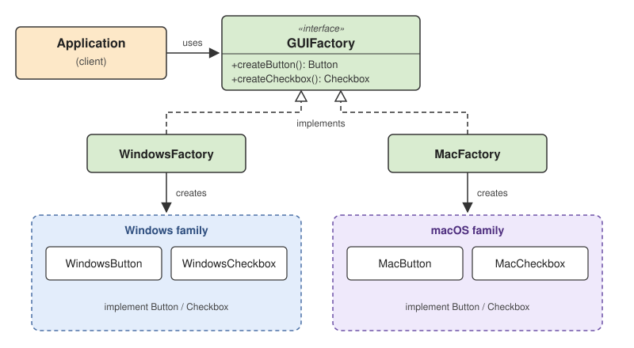

# 3 — Abstract Factory Pattern



> Provide an interface for creating families of related or dependent objects without
> specifying their concrete classes.

## 💡 The idea

The definition has three key ideas:

- **Family:** several objects that belong together (a button *and* a checkbox *and* a menu)
- **Related:** they are designed to work together or share one theme, platform, or
  environment (all Windows, or all macOS)
- **Without specifying concrete classes:** the client code works with `Button` and
  `Checkbox` interfaces and never writes `new WindowsButton()`

The [Factory Method](../2-FACTORY-METHOD/) answers *"which implementation of **one** product
do I create?"*. Abstract Factory answers a bigger question: *"which **matching set** of
products do I create?"*. One factory object stands for one whole family, so choosing the
factory chooses every product at once, and they always match.

### The big picture

| Question | Factory Method | Abstract Factory |
|---|---|---|
| **Main goal** | Let subclasses decide which product to create | Create families of related products |
| **Products** | One product type (`Exporter`) | Several product types (`Button`, `Checkbox`) |
| **Mechanism** | One overridable creation method | An interface with one creation method per product type |
| **Typical variation** | PDF vs. CSV exporter | Windows vs. macOS UI, AWS vs. Azure services |
| **What the client holds** | A creator, and one product interface | A factory, and several product interfaces |

One rule to remember:

- *"Which implementation of **one** product?"* → **Factory Method**
- *"Which compatible **family** of products?"* → **Abstract Factory**

## Use case

A desktop application runs on Windows and macOS. Its screen has two components, a button and
a checkbox, and both must match the operating system's look:

| | Button | Checkbox |
|---|---|---|
| **Windows family** | `WindowsButton` | `WindowsCheckbox` |
| **macOS family** | `MacButton` | `MacCheckbox` |

A Windows button next to a macOS checkbox is a bug. The application must always pick a
**consistent row** of this table. Then the company decides to support Linux too.

## ❌ Bad example

```java
class Application {
    private final Button button;
    private final Checkbox checkbox;

    public Application(String os) {
        // decision #1: which button?
        if (os.equals("WINDOWS")) {
            button = new WindowsButton();
        } else if (os.equals("MAC")) {
            button = new MacButton();
        } else if (os.equals("LINUX")) {
            button = new LinuxButton();
        } else {
            throw new IllegalArgumentException("Unsupported OS: " + os);
        }

        // decision #2: which checkbox? Made separately... and LINUX was forgotten here
        if (os.equals("MAC")) {
            checkbox = new MacCheckbox();
        } else {
            checkbox = new WindowsCheckbox();
        }
    }

    public void renderUI() {
        button.render();
        checkbox.render();
    }
}
```

On Linux this prints:

```
Rendering Linux button
Rendering Windows checkbox
```

👉 Problems:

- Each component is chosen by its own `if`/`else`, so nothing guarantees a matching set
- The forgotten branch doesn't fail. It silently produces a mixed, broken UI
- Adding a platform means editing every `if`/`else` in `Application`, one per component
- `Application` knows all six concrete classes by name

🔎 SOLID violations:

| Principle | What violates it | Why |
|---|---|---|
| **OCP** | One `if`/`else` per component inside `Application` | A new platform forces edits to `Application`, a class that already worked, once per component type |
| **DIP** | `new WindowsButton()`, `new MacCheckbox()`, ... inside `Application` | High-level UI code depends on concrete platform classes instead of only on `Button` and `Checkbox` |
| **SRP** | `Application` renders the screen *and* builds platform-specific objects | Two reasons to change: the screen layout, and the list of supported platforms |

## ✅ Good example

Built in five steps. The complete, runnable version is in
[`examples/02-good-example`](./examples/02-good-example/Main.java).

**Step 1 — Abstract products.** What the application knows: what a button and a checkbox can
do, not how each platform does it.

```java
interface Button {
    void render();
}

interface Checkbox {
    void render();
}
```

**Step 2 — Concrete products.** One implementation per platform. Each class belongs to exactly
one family.

```java
class WindowsButton implements Button {
    public void render() {
        System.out.println("Rendering Windows button");
    }
}

class WindowsCheckbox implements Checkbox {
    public void render() {
        System.out.println("Rendering Windows checkbox");
    }
}

class MacButton implements Button {
    public void render() {
        System.out.println("Rendering macOS button");
    }
}

class MacCheckbox implements Checkbox {
    public void render() {
        System.out.println("Rendering macOS checkbox");
    }
}
```

**Step 3 — The abstract factory.** One creation method per product type. This interface *is*
the definition of a family: "a family is something that can give me a button and a checkbox".

```java
interface GUIFactory {
    Button createButton();
    Checkbox createCheckbox();
}
```

**Step 4 — Concrete factories.** One per family. Each one only returns products of its own
family, so mixing is impossible.

```java
class WindowsFactory implements GUIFactory {
    public Button createButton() {
        return new WindowsButton();
    }

    public Checkbox createCheckbox() {
        return new WindowsCheckbox();
    }
}

class MacFactory implements GUIFactory {
    public Button createButton() {
        return new MacButton();
    }

    public Checkbox createCheckbox() {
        return new MacCheckbox();
    }
}
```

**Step 5 — The client.** `Application` receives one factory and uses only interfaces.

```java
class Application {
    private final Button button;
    private final Checkbox checkbox;

    public Application(GUIFactory factory) {
        button = factory.createButton();
        checkbox = factory.createCheckbox();
    }

    public void renderUI() {
        button.render();
        checkbox.render();
    }
}
```

The factory is chosen **once**, when the application starts:

```java
GUIFactory factory = new MacFactory();      // the only platform-specific line
Application app = new Application(factory);
app.renderUI();
```

```
Rendering macOS button
Rendering macOS checkbox
```

Switch to `new WindowsFactory()` and the whole UI switches with it. The application logic
doesn't change.

### The five roles

| Role | In this example | Job |
|---|---|---|
| **Abstract product** | `Button`, `Checkbox` | The interfaces the client uses |
| **Concrete product** | `WindowsButton`, `MacCheckbox`, ... | The real objects, each belonging to one family |
| **Abstract factory** | `GUIFactory` | Declares one creation method per product type |
| **Concrete factory** | `WindowsFactory`, `MacFactory` | Creates every product of *one* family |
| **Client** | `Application` | Uses the factory and the products through interfaces only |

How it runs, in order:

1. At startup, the program picks **one** concrete factory (from configuration, the OS name,
   and so on)
2. The application receives that factory
3. The factory creates the button and the checkbox, both from the same family
4. The application stores and uses them through their interfaces, never knowing their classes

### Adding Linux

```java
class LinuxButton implements Button {
    public void render() {
        System.out.println("Rendering Linux button");
    }
}

class LinuxCheckbox implements Checkbox {
    public void render() {
        System.out.println("Rendering Linux checkbox");
    }
}

class LinuxFactory implements GUIFactory {
    public Button createButton() {
        return new LinuxButton();
    }

    public Checkbox createCheckbox() {
        return new LinuxCheckbox();
    }
}
```

👉 Three new classes, and `Application`, `WindowsFactory`, and `MacFactory` are **not touched**.
The only existing line that changes is the startup code that maps `"LINUX"` to
`new LinuxFactory()`. That mapping is a small [Simple Factory](../2-FACTORY-METHOD/#-good-example-step-1-simple-factory)
that picks the family, and it lives at the edge of the application, not in the business code.

### SOLID: what the pattern preserves, and what it costs

| Principle | Result | Why |
|---|---|---|
| **SRP** | ✅ Preserved | `Application` only renders. Building platform objects is the factories' only job |
| **OCP** | ✅ For new **families** | Linux = new classes only. No working class is edited |
| | ⚠️ Not for new **product types** | A `Slider` means a new method on `GUIFactory` *and* in every concrete factory (see the trade-off below) |
| **LSP** | ✅ Preserved, if you keep the promise | Any `GUIFactory` can replace another, as long as each one returns a **complete, matching** family. A factory that returns a Mac checkbox from `WindowsFactory` breaks that promise |
| **ISP** | ⚠️ Watch the size | A factory with 15 creation methods forces every family to implement all 15. If clients only use some of them, split it into smaller factories |
| **DIP** | ✅ Preserved | `Application` depends only on `GUIFactory`, `Button`, and `Checkbox`. Concrete classes are named only inside the factories |

## ⚠️ The trade-off: new families are cheap, new product types are expensive

Think of the families and products as a grid:

| | `Button` | `Checkbox` | `Slider` *(new type)* |
|---|---|---|---|
| **Windows** | `WindowsButton` | `WindowsCheckbox` | ➕ `WindowsSlider` |
| **macOS** | `MacButton` | `MacCheckbox` | ➕ `MacSlider` |
| **Linux** *(new family)* | ➕ `LinuxButton` | ➕ `LinuxCheckbox` | ➕ `LinuxSlider` |

| Change | What you add | What you **edit** |
|---|---|---|
| **New family** (a new row: Linux) | 1 factory + 1 class per product | Nothing, except the startup line that picks the factory |
| **New product type** (a new column: Slider) | 1 interface + 1 class per family | `GUIFactory` **and every concrete factory** |

So Abstract Factory fits best when the **set of product types is stable** and **new families
keep coming**. If you add new product types every week, the pattern will fight you.

## Not only for UIs

The same structure appears wherever a group of objects must be switched **as a unit**:

| Domain | Abstract factory | Families |
|---|---|---|
| Databases | `DatabaseFactory`: connection + transaction manager | PostgreSQL / MySQL |
| Cloud providers | `CloudFactory`: object storage + message queue | AWS (S3 + SQS) / Azure (Blob + Queue) |
| Production vs. tests | `InfrastructureFactory`: repository + event publisher | Production (PostgreSQL + Kafka) / Test (in-memory + recorder) |

The last row is in [`examples/03-production-vs-test`](./examples/03-production-vs-test/Main.java).
The same `OrderService` runs against a real database and Kafka in production, and against
in-memory fakes in a test, and switching the factory guarantees that a test never saves to
memory while publishing real events to production. Dependency injection frameworks often do
this job too. Abstract Factory is the same idea written by hand, and the two work fine
together.

## Can Abstract Factory use Factory Method?

Yes. They describe different things and are often used together:

- **Factory Method** is about *one creation method* that a subclass decides
- **Abstract Factory** is about *a group of creation methods* that together create one family

Each method of `GUIFactory` (`createButton()`, `createCheckbox()`) is a product-creation
method that a concrete factory decides. The class as a whole is the Abstract Factory, because
it creates the entire family.

## When to use it, and when not to

**Use Abstract Factory when:**

- Several objects must be **consistent with each other** (same platform, same vendor, same
  environment)
- You need to switch the whole group **as a unit**, by configuration or for tests
- New families are expected, and the list of product types is stable

**Don't use Abstract Factory when:**

- You create only **one** kind of product. Use a [Factory Method or Simple
  Factory](../2-FACTORY-METHOD/) instead
- There is only one family, and no second one is planned. That is just extra interfaces
- New product types are added all the time. Each one means editing every factory

## How to spot that you need it

- Several `if`/`else` or `switch` blocks check **the same value** (`os`, `provider`, `env`) to
  create **different** objects
- A bug where objects from different families end up together (a Mac checkbox in a Windows
  window, an Azure file announced on an AWS queue, a test writing to a production queue)
- Adding a new vendor, platform, or environment means editing many classes
- Classes take a `type` or `provider` string only to pass it to their own `new` decisions

## Real-world mapping

- **Swing look-and-feel** (`UIManager.setLookAndFeel(...)`): switching the look-and-feel
  switches how every component is created and drawn, as one family
- **AWT `Toolkit`**: the platform-specific toolkit creates matching native pieces (windows,
  fonts, images) for the operating system
- **JDBC**: a vendor's `Connection` creates a matching `Statement`, `PreparedStatement`, and
  `CallableStatement`, all from the same driver
- **Apache jclouds**: one provider setting gives you a matching set of compute and storage
  services for that cloud

## 🧠 Test yourself

Your application supports AWS and Azure. Each provider needs a storage client, a message
queue client, and an authentication client, and you want to switch provider without changing
business logic. Which pattern fits better?

<details>
<summary>Answer</summary>

**Abstract Factory.** There are three product types (storage, queue, authentication) that must
come from the **same** provider. A `CloudFactory` with `createStorage()`, `createQueue()`, and
`createAuth()`, implemented by `AwsFactory` and `AzureFactory`, guarantees a consistent set.
Factory Method would only decide one product at a time and couldn't stop you from mixing an
AWS queue with Azure storage.

</details>

## Examples

| # | Focus |
|---|-------|
| 01 | Each component chosen by its own `if`/`else`; on Linux the UI becomes a mix of two platforms (violation) |
| 02 | `GUIFactory` with `WindowsFactory`, `MacFactory`, and a `LinuxFactory` added with zero edits (fixed) |
| 03 | The same pattern outside UIs: production vs. test infrastructure, with checks that run without a database |

## Build & run

```sh
cd examples/01-bad-example
javac Main.java && java Main
```

```sh
cd examples/02-good-example
javac Main.java && java Main
```

```sh
cd examples/03-production-vs-test
javac Main.java && java Main
```

## 🏋️ Practice exercise

Once the examples above make sense, apply Abstract Factory yourself on a fresh scenario:

### [Exercise: Multi-Cloud File Upload →](./exercise/)

An upload service picks its storage and its message queue separately, and a half-finished
cloud migration has left files in Azure announced on an AWS queue. Make the provider a single,
consistent family.

## Next

### [4. Builder →](../4-BUILDER/)
