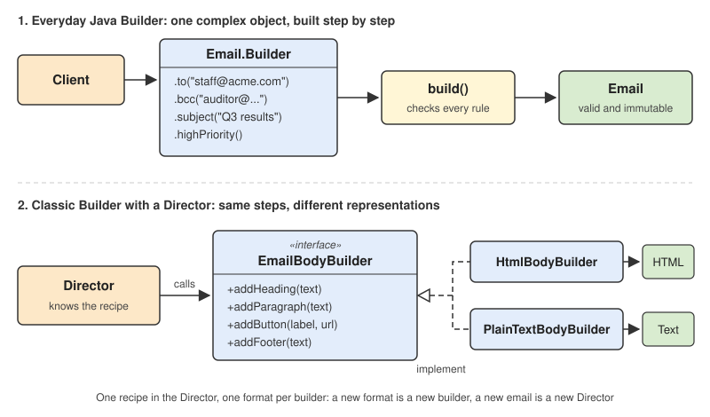

# 4 — Builder Pattern



> Separate the construction of a complex object from its representation, so that the same
> construction process can create different representations.

## 💡 The idea

Some objects have many parts, and most of them are optional. An email has a sender,
recipients, CC, BCC, a subject, a body, attachments, a priority... Creating one in a single
`new` call quickly turns into a line nobody can read, and a line where arguments can be
silently swapped.

A Builder lets you create the object **step by step, with a named method for each part**, and
then hands you the finished object in one final call:

```java
Email email = Email.from("ceo@acme.com")
        .to("staff@acme.com")
        .bcc("auditor@external.com")
        .subject("Q3 results")
        .highPriority()
        .build();          // checks the rules, then creates the Email
```

Three things happen here that plain constructors can't give you together:

- **Every value is named.** You can't pass the BCC address where the CC belongs by accident
- **Optional parts are simply left out.** No `null, null, false` to fill the gaps
- **The object is checked once and then frozen.** `build()` validates everything, and the
  `Email` it returns can never be half-built or changed later

### The big picture

"Builder" is used for two related designs. This lesson walks through both, in this order:

| | Everyday Java Builder | Classic Builder with a Director |
|---|---|---|
| **Problem it solves** | One object with many (optional) parts | The same steps must produce **different representations** |
| **What you write** | A nested `Builder` class with one method per part and a `build()` | A builder *interface*, several builders, and a **Director** that knows the recipe |
| **Example** | `Email.from(...).to(...).subject(...).build()` | One welcome email, produced as HTML *and* as plain text |
| **Where you meet it** | Everywhere: `HttpRequest.newBuilder()`, Lombok `@Builder`, most Java libraries | Document generators, parsers and converters, report engines |
| **In this lesson** | [Step 1](#-good-example-step-1-the-everyday-java-builder) | [Step 2](#-good-example-step-2-the-classic-builder-with-a-director) |

The first form is what most Java developers mean by "Builder". The second is the original
Gang of Four pattern, and where the definition at the top comes from.

## Use case

Your application sends emails: newsletters, invoice reminders, welcome mails. An email has:

| Part | Required? |
|---|---|
| sender | **yes** |
| at least one recipient (to, CC, or BCC) | **yes** |
| subject | **yes** |
| CC and BCC recipients | no |
| body, as plain text or HTML | no |
| high priority | no, normally off |
| attachments | no, at most 10 |

Two rules matter in practice: BCC recipients must never be visible to the others, and an
email without a recipient must never be sent.

## ❌ Bad example

The two classic ways to create an object with many optional parts. Both compile, and both let
broken emails through.

**Way 1: telescoping constructors**, one more parameter each time:

```java
class Email {
    public Email(String from, String to, String subject) { ... }
    public Email(String from, String to, String subject, String body) { ... }
    public Email(String from, String to, String cc, String bcc, String subject,
                 String body, boolean html, boolean highPriority) { ... }
}

// Which argument is which?
Email quarterly = new Email("ceo@acme.com", "staff@acme.com",
        "auditor@external.com", null,      // meant as BCC, passed as CC!
        "Q3 results", "<h1>Great quarter</h1>", false, true);   // html and priority swapped
```

`cc` and `bcc` are both `String`, and `html` and `highPriority` are both `boolean`, so the
compiler can't help. The secret auditor is now visible to the whole company.

**Way 2: JavaBeans setters**, set whatever you like, in any order:

```java
Email reminder = new Email();
reminder.setFrom("noreply@acme.com");
reminder.setSubject("Your invoice is due");
reminder.send();                    // sent to: null. Nobody checked
```

Nothing forces the object to be complete before it is used. And because it stays mutable,
anyone holding a reference can change a "finished" email:

```java
Email copyForAudit = welcome;           // a shared reference
copyForAudit.setTo("everyone@acme.com");  // the original welcome mail now goes to everyone
```

👉 Problems:

- **Long parameter lists:** call sites are unreadable, and arguments of the same type can be
  swapped without any compiler error
- **Constructor explosion:** every new optional field means yet another constructor, or one
  more argument added to every existing call
- **Half-built objects:** with setters, no rule is checked before the object is used
- **Mutability:** a "finished" object can be changed by anyone holding a reference to it

🔎 SOLID check: **no SOLID principle is clearly violated here.** These are problems of
**readability, correctness, and mutability**, and those are exactly what the Builder fixes.
The classic form in [step 2](#-good-example-step-2-the-classic-builder-with-a-director) does
bring a SOLID benefit (SRP and OCP), shown there.

## ✅ Good example, step 1: the everyday Java Builder

The complete, runnable version is in
[`examples/02-good-example`](./examples/02-good-example/Main.java). Here is the whole class,
with each ingredient numbered:

```java
final class Email {
    // 1. every field is final: once built, an Email never changes
    private final String from;
    private final List<String> to;
    private final List<String> cc;
    private final List<String> bcc;
    private final String subject;
    private final String body;
    private final boolean html;
    private final boolean highPriority;
    private final List<String> attachments;

    // 2. private constructor: the only way to get an Email is through the Builder
    private Email(Builder builder) {
        this.from = builder.from;
        this.to = List.copyOf(builder.to);              // copies: nobody can change them later
        this.cc = List.copyOf(builder.cc);
        this.bcc = List.copyOf(builder.bcc);
        this.subject = builder.subject;
        this.body = builder.body;
        this.html = builder.html;
        this.highPriority = builder.highPriority;
        this.attachments = List.copyOf(builder.attachments);
    }

    // 3. the entry point; required values go here, so they can't be forgotten
    public static Builder from(String sender) {
        return new Builder(sender);
    }

    public List<String> getTo() {
        return to;                                      // read-only: List.copyOf made it so
    }

    // send() prints the email; see the example file

    // 4. the Builder: mutable while building, thrown away afterwards
    public static final class Builder {
        private final String from;
        private final List<String> to = new ArrayList<>();
        private final List<String> cc = new ArrayList<>();
        private final List<String> bcc = new ArrayList<>();
        private String subject = "";
        private String body = "";
        private boolean html = false;
        private boolean highPriority = false;
        private final List<String> attachments = new ArrayList<>();

        private Builder(String from) {
            this.from = from;
        }

        // 5. one named method per option; each returns `this`, so calls can be chained
        public Builder to(String address) {
            to.add(address);
            return this;
        }

        public Builder cc(String address) {
            cc.add(address);
            return this;
        }

        public Builder bcc(String address) {
            bcc.add(address);
            return this;
        }

        public Builder subject(String subject) {
            this.subject = subject;
            return this;
        }

        public Builder textBody(String body) {
            this.body = body;
            this.html = false;
            return this;
        }

        public Builder htmlBody(String body) {
            this.body = body;
            this.html = true;
            return this;
        }

        public Builder highPriority() {
            this.highPriority = true;
            return this;
        }

        public Builder attach(String fileName) {
            attachments.add(fileName);
            return this;
        }

        // 6. build(): checks every rule in ONE place, then creates the finished object
        public Email build() {
            if (from == null || !from.contains("@")) {
                throw new IllegalStateException("A valid sender is required");
            }
            if (to.isEmpty() && cc.isEmpty() && bcc.isEmpty()) {
                throw new IllegalStateException("An email needs at least one recipient");
            }
            if (subject.isBlank()) {
                throw new IllegalStateException("An email needs a subject");
            }
            if (attachments.size() > 10) {
                throw new IllegalStateException("At most 10 attachments are allowed");
            }
            return new Email(this);
        }
    }
}
```

What each ingredient is for:

| # | Ingredient | Why it's there |
|---|---|---|
| 1 | `final` fields | The finished object can never change, so it is safe to share and pass around |
| 2 | `private` constructor taking the `Builder` | Nobody can skip the builder, so nobody can skip the checks in `build()` |
| 3 | A static entry point taking the **required** values | A required value can't be forgotten: without a sender you can't even start |
| 4 | A `static` nested `Builder` class | It holds the work-in-progress values. It's mutable, but it lives only while building |
| 5 | One named method per option, returning `this` | Readable, chainable call sites. Defaults are set in the builder's fields, so options can be skipped |
| 6 | `build()` | The single place where all rules are checked. An invalid `Email` can never exist |
| | `List.copyOf(...)` | Copies the lists into read-only ones, so the builder (or anyone else) can't change them afterwards |

The three problems from the bad example are now gone:

```java
// 1. every value is named: the auditor can't end up in CC by accident
Email quarterly = Email.from("ceo@acme.com")
        .to("staff@acme.com")
        .bcc("auditor@external.com")
        .subject("Q3 results")
        .htmlBody("<h1>Great quarter</h1>")
        .highPriority()
        .build();

// 2. a half-built email can't be created
Email.from("noreply@acme.com")
        .subject("Your invoice is due")
        .build();           // IllegalStateException: An email needs at least one recipient

// 3. a finished email can't be changed
welcome.getTo().add("everyone@acme.com");   // UnsupportedOperationException
```

And a new optional part (say, `replyTo`) is **one new builder method**. Every existing call
site keeps compiling and keeps working.

## ✅ Good example, step 2: the classic Builder with a Director

Step 1 builds **one kind of object**. The original Gang of Four Builder solves a different
problem: the **same construction steps** must produce **different representations**.

Real emails carry their body twice: an HTML version for modern mail clients, and a plain-text
version for everything else. Both must contain exactly the same content, in the same order.
If two separate pieces of code build them, they drift apart.

The solution splits the work into two roles:

- The **Director** knows the **recipe**: which steps, in which order ("heading, paragraph,
  button, footer")
- Each **Builder** knows a **format**: how one step looks in HTML, or in plain text

```java
// The builder interface: the construction steps
interface EmailBodyBuilder {
    void addHeading(String text);
    void addParagraph(String text);
    void addButton(String label, String url);
    void addFooter(String text);
}

// Concrete builder #1: produces HTML
class HtmlBodyBuilder implements EmailBodyBuilder {
    private final StringBuilder html = new StringBuilder();

    public void addHeading(String text) {
        html.append("<h1>").append(text).append("</h1>\n");
    }

    public void addParagraph(String text) {
        html.append("<p>").append(text).append("</p>\n");
    }

    public void addButton(String label, String url) {
        html.append("<a class=\"button\" href=\"").append(url).append("\">").append(label).append("</a>\n");
    }

    public void addFooter(String text) {
        html.append("<footer>").append(text).append("</footer>\n");
    }

    public String getResult() {
        return html.toString();
    }
}

// Concrete builder #2: produces plain text
class PlainTextBodyBuilder implements EmailBodyBuilder {
    private final StringBuilder text = new StringBuilder();

    public void addHeading(String heading) {
        text.append(heading.toUpperCase()).append("\n").append("=".repeat(heading.length())).append("\n\n");
    }

    public void addParagraph(String paragraph) {
        text.append(paragraph).append("\n\n");
    }

    public void addButton(String label, String url) {
        text.append(label).append(": ").append(url).append("\n\n");
    }

    public void addFooter(String footer) {
        text.append("-- \n").append(footer).append("\n");
    }

    public String getResult() {
        return text.toString();
    }
}

// The Director: knows the RECIPE, not the format
class WelcomeEmailDirector {
    public void construct(EmailBodyBuilder builder, String userName) {
        builder.addHeading("Welcome, " + userName + "!");
        builder.addParagraph("Thanks for joining Acme. Your account is ready.");
        builder.addButton("Confirm your email", "https://acme.com/confirm");
        builder.addFooter("Acme Inc. You can unsubscribe at any time.");
    }
}
```

Using it:

```java
WelcomeEmailDirector director = new WelcomeEmailDirector();

HtmlBodyBuilder html = new HtmlBodyBuilder();
director.construct(html, "Jane");
String htmlBody = html.getResult();

PlainTextBodyBuilder text = new PlainTextBodyBuilder();
director.construct(text, "Jane");
String textBody = text.getResult();
```

The HTML version:

```html
<h1>Welcome, Jane!</h1>
<p>Thanks for joining Acme. Your account is ready.</p>
<a class="button" href="https://acme.com/confirm">Confirm your email</a>
<footer>Acme Inc. You can unsubscribe at any time.</footer>
```

The plain-text version, from the same recipe:

```
WELCOME, JANE!
==============

Thanks for joining Acme. Your account is ready.

Confirm your email: https://acme.com/confirm

--
Acme Inc. You can unsubscribe at any time.
```

The four roles:

| Role | In this example | Job |
|---|---|---|
| **Builder** | `EmailBodyBuilder` | Declares the construction steps |
| **Concrete builder** | `HtmlBodyBuilder`, `PlainTextBodyBuilder` | Implements the steps for one format, and returns the result |
| **Director** | `WelcomeEmailDirector` | Calls the steps in the right order: the recipe |
| **Product** | The HTML string, the plain-text string | What the concrete builders produce |

`getResult()` sits on the concrete builders, not on the interface, because different builders
often produce completely different types (a `String`, a `PdfDocument`, a `byte[]`).

### SOLID: what the classic form gives you

| Principle | Result | Why |
|---|---|---|
| **SRP** | ✅ | The recipe (Director) and the format (Builder) change for different reasons, so they live in different classes |
| **OCP** | ✅ | A Markdown version is one new builder, and the Director is untouched. A password-reset email is one new Director, and the builders are untouched |
| **LSP** | ✅ | The Director works with any `EmailBodyBuilder`, so every builder must handle every step |
| **DIP** | ✅ | The Director depends only on the `EmailBodyBuilder` interface |

## Which one should I use?

| Situation | Use |
|---|---|
| 1 to 3 parameters, all required | **A plain constructor.** A builder would only add noise |
| A few variants with clear names (`Duration.ofSeconds(5)`) | **A static factory method** |
| Many parameters, most optional, with rules between them, and immutability wanted | **The everyday Java Builder** (step 1) |
| The same construction steps must produce several representations | **The classic Builder with a Director** (step 2) |

### Builder vs. Abstract Factory

Both are creational, and both hide concrete classes, but they answer different questions:

| | Abstract Factory | Builder |
|---|---|---|
| **Creates** | A *family* of related objects | *One* complex object |
| **How** | Each object in one call (`createButton()`) | Step by step, then `build()` |
| **Focus** | *Which* classes, so they match | *How* the object is assembled, and that it ends up valid |

## Common mistakes

- **Required values as builder methods.** If `to()` is just another optional method, forgetting
  it is only caught when `build()` runs. Put truly required values in the entry point
  (`Email.from(sender)`) so they can't be skipped
- **No validation in `build()`.** Then the builder is only a nicer way to create invalid
  objects
- **Leaking mutable state.** If the product keeps the builder's `ArrayList` instead of a copy,
  changing the builder later changes the "finished" object
- **Reusing one builder for several objects.** After `build()`, start a new builder, unless
  you deliberately design yours to be reusable
- **A builder for everything.** A class with two fields doesn't need one

## How to spot that you need it

- A constructor with more than about four parameters, especially several of the same type
- Call sites full of `null`, `false`, or `0` just to reach the parameter you need
- Several constructor overloads that call each other ("telescoping")
- Objects created empty and then filled with setters, and bugs where one was used before it
  was complete
- The same content must be produced in two or more formats, and the two versions keep
  drifting apart

## Real-world mapping

- `HttpRequest.newBuilder().uri(...).header(...).GET().build()` and `HttpClient.newBuilder()`:
  everyday Builders in the JDK
- `Locale.Builder`, `Stream.builder()`, `ProcessBuilder`
- `StringBuilder`: builds one `String` step by step, though without the validation step
- Lombok's `@Builder` generates the whole step 1 builder from a class's fields
- Document and report libraries (for example, writing the same report as PDF or as
  spreadsheet): the classic Builder with a Director

## Examples

| # | Focus |
|---|-------|
| 01 | Telescoping constructors and setters: swapped arguments, a half-built email, a mutated "finished" email (problem) |
| 02 | The everyday Java Builder: named options, validation in `build()`, an immutable `Email` (fixed) |
| 03 | The classic Builder with a Director: one welcome email, built as HTML and as plain text |

## Build & run

```sh
cd examples/01-bad-example
javac Main.java && java Main
```

```sh
cd examples/02-good-example
javac Main.java && java Main
```

```sh
cd examples/03-director
javac Main.java && java Main
```

## 🏋️ Practice exercise

Once the examples above make sense, apply Builder yourself on a fresh scenario:

### [Exercise: Database Connection Config →](./exercise/)

A database configuration with nine options and two swapped `boolean`s has just turned off SSL
in production. Replace the telescoping constructors with a validating Builder, then add
ready-made presets with a Director.

## Next

### 5. Prototype *(coming soon)*

Back to [Creational Patterns](../README.md).
