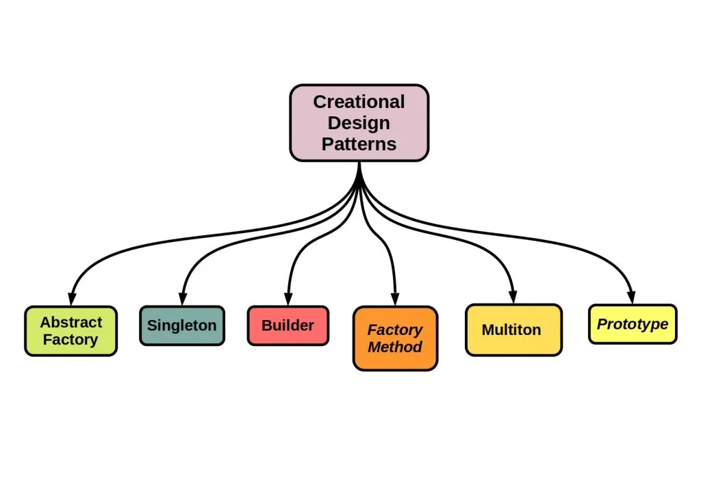

# 1 — Creational Design Patterns



> Creational patterns decide **how objects are created**, so the code that *uses* an object
> doesn't have to know *how to build* it.

## 💡 The idea

In plain Java, an object is created with `new ConcreteClass(...)`. That one line looks
harmless, but it makes three decisions at once and hard-codes them into the caller:

- **Which** class to instantiate (`new MySqlDatabase()`, not `PostgresDatabase`)
- **How** to build it (which constructor, in which order, with which 9 parameters)
- **How many** instances exist (a fresh one every time, or one shared instance?)

Creational patterns move those decisions **out of the business logic** and into one dedicated
place. The rest of the code just asks for an object and gets one, without knowing its concrete
class, its construction steps, or its lifecycle.

In SOLID terms, this is **DIP** applied to object creation. You can depend on an abstraction
all you like, but if you still write `new ConcreteClass()` everywhere, you're coupled to the
concrete class anyway.

## Use case

Imagine a notification module that sends messages over Email, SMS, or Push. Every place in
the codebase that sends a notification has to pick the right class:

- The order service creates an `EmailNotification`
- The login service creates an `SmsNotification` for 2FA
- The marketing service creates a `PushNotification`

Now product asks for WhatsApp. You have to find every `if`/`switch` that picks a channel and
every `new XxxNotification()`, edit each one, and re-test each service. The creation logic
has **leaked everywhere**. That is exactly the pain creational patterns remove.

## ❌ Bad example

```java
class OrderService {
    public void confirmOrder(String channel, String recipient) {
        Notification notification;

        // creation logic lives inside business logic
        if (channel.equals("EMAIL")) {
            notification = new EmailNotification();
        } else if (channel.equals("SMS")) {
            notification = new SmsNotification();
        } else if (channel.equals("PUSH")) {
            notification = new PushNotification();
        } else {
            throw new IllegalArgumentException("Unknown channel: " + channel);
        }

        notification.send(recipient, "Your order is confirmed");
    }
}
```

👉 Problems:

- `OrderService` knows about **every** concrete notification class
- The same `if`/`else` gets copy-pasted into every service that sends notifications
- Adding a new channel means editing working business code (an OCP violation)
- Hard to unit test: you can't swap in a fake notification without changing the class

🔎 SOLID violations:

| Principle | What violates it | Why |
|---|---|---|
| **OCP** | The `if`/`else` chain inside `confirmOrder()` | Adding WhatsApp means editing `OrderService`, a class that already worked |
| **DIP** | `new EmailNotification()`, `new SmsNotification()`, ... | High-level business logic depends on every concrete class instead of only on `Notification` |
| **SRP** | `OrderService` confirms orders *and* decides which class to build | It has two reasons to change: the order workflow, and the list of channels |

The fix below removes all three from `OrderService`: it depends only on `Notification`, and a
new channel no longer touches it.

## ✅ Good example

```java
class NotificationFactory {
    public static Notification create(String channel) {
        return switch (channel) {
            case "EMAIL" -> new EmailNotification();
            case "SMS"   -> new SmsNotification();
            case "PUSH"  -> new PushNotification();
            default -> throw new IllegalArgumentException("Unknown channel: " + channel);
        };
    }
}

class OrderService {
    public void confirmOrder(String channel, String recipient) {
        Notification notification = NotificationFactory.create(channel);
        notification.send(recipient, "Your order is confirmed");
    }
}
```

👉 Creation now lives in **one** place. `OrderService` only knows the `Notification`
abstraction. A new channel touches the factory, and no business code at all.

This simple factory is only the starting point. The patterns below are more refined answers
to the same question, each for a different kind of creation problem.

## How to spot that you need a creational pattern

- The same `if`/`switch` that picks a concrete class appears in several places
- Business logic is littered with `new SomeConcreteClass()` for things that could vary
- A constructor has so many parameters that call sites are unreadable
  (`new User("Jane", null, null, true, false, 30, null)`)
- Objects must come in **matching families** (dark-theme button + dark-theme checkbox) and
  nothing stops you from mixing them up
- Creating an object is expensive (heavy setup, I/O), but you need many similar copies
- Exactly one instance must exist (a config, a connection pool), or one per key

## Patterns in this family

| # | Pattern | In one sentence | The pain it removes | Status |
|---|---|---|---|---|
| 1 | [**Singleton**](./1-SINGLETON/) | Guarantee exactly one instance with a global access point | Multiple conflicting instances of a shared resource | ✅ available |
| 2 | **Factory Method** | Let subclasses decide which concrete class to create | `if`/`switch` on type scattered around the code | 🚧 coming soon |
| 3 | **Abstract Factory** | Create *families* of related objects without naming their classes | Mixing incompatible objects (Windows button + macOS menu) | 🚧 coming soon |
| 4 | **Builder** | Construct a complex object step by step | Telescoping constructors and unreadable call sites | 🚧 coming soon |
| 5 | **Prototype** | Create new objects by cloning an existing one | Expensive or complicated setup repeated for every copy | 🚧 coming soon |
| 6 | **Multiton** | Guarantee exactly one instance *per key* | One registry of named instances managed by hand | 🚧 coming soon |

> **Why Singleton is first:** it's the smallest pattern, one class with three ingredients, so
> it's the easiest place to learn how a pattern lesson works. It's also the most misused
> pattern: a Singleton is global state in disguise, which hides dependencies and makes testing
> hard. The lesson covers when it's the right tool and when it isn't.
> Multiton is not one of the original "Gang of Four" patterns. It extends the Singleton idea to
> one instance per key.

## Start learning

### [1. Singleton →](./1-SINGLETON/)

## Common misconceptions

- **"Factories are just a fancy `new`."** No. The value is *where* the decision lives. One
  factory replaces N copies of the same selection logic.
- **"Builder is only for objects with many fields."** It's also for objects that must be
  **valid and immutable** once built, with validation in one place (`build()`).
- **"Singleton is good because it saves memory."** Memory is rarely the reason. Use it when
  *correctness* requires exactly one instance, and prefer dependency injection to pass that
  instance around.

## Real-world mapping

- `Calendar.getInstance()`, `NumberFormat.getInstance()`, `List.of(...)`: factory methods in
  the JDK
- `StringBuilder`, `HttpRequest.newBuilder()`, Lombok's `@Builder`: Builder
- `Object.clone()`, copy constructors: Prototype
- Spring beans (singleton scope by default), `Runtime.getRuntime()`: Singleton
- `DocumentBuilderFactory`, JDBC `DriverManager.getConnection(...)`: factories hiding the
  concrete implementation

## Next

### [2. Structural Patterns →](../2-STRUCTURAL-PATTERNS/)
