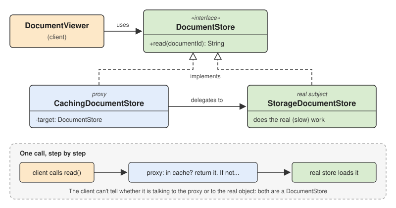

# 4 — Proxy Pattern



> Provide a surrogate or placeholder for another object to control access to it.

## 💡 The idea

A proxy is an object that **stands in front of another object** and has **exactly the same
interface**. The client thinks it is talking to the real object. In fact every call goes
through the proxy first, and the proxy decides what happens:

- **Whether** the call reaches the real object at all (access control)
- **When** the real object is created (only when it is first needed)
- **How often** the real object is really asked (cache the answer)
- **What else** happens around the call (log it, count it, time it)

The real object stays focused on its one job and doesn't know the proxy exists. The client
doesn't know either: it holds an interface, and a proxy fits that interface just like the
real object does.

A real-life comparison: a bank card is a proxy for your bank account. A shop can "take money"
from either one, but the card adds checks (PIN, daily limit) before the account is touched,
and the account itself doesn't change.

### The big picture

Every proxy has the same three parts, as in the diagram above:

| Part | In this lesson | Job |
|---|---|---|
| **Subject** | `DocumentStore` interface | The interface the client uses. Both the real object and the proxy implement it |
| **Real subject** | `StorageDocumentStore` | Does the real work, and nothing else |
| **Proxy** | `CachingDocumentStore`, `AccessControlledDocumentStore` | Holds a reference to the real subject, and controls every call before passing it on |

The proxy types differ only in **what they control**:

| Kind of proxy | Controls | Typical use |
|---|---|---|
| **Protection proxy** | *Who* may call | Permission checks, roles, plans |
| **Caching proxy** | *How often* the real object is asked | Slow databases, paid APIs |
| **Virtual proxy** | *When* the real object is created | Heavy objects that may never be used (lazy loading) |
| **Remote proxy** | *Where* the real object lives | Calling an object on another machine as if it were local |
| **Logging / smart proxy** | *What else* happens around the call | Audit logs, metrics, reference counting |

## Use case

A company intranet stores documents in slow storage, and reading one takes a while. Three
extra rules apply:

- Documents under `hr/` may only be read by the HR manager
- Popular documents (the handbook) are opened hundreds of times a day, so they should be
  loaded from storage only once
- Every read, allowed or denied, must be written to an audit log

The easy first version puts all of that into the class that reads from storage.

## ❌ Bad example

```java
class DocumentStore {
    private final Map<String, String> cache = new HashMap<>();
    private int storageReads = 0;

    public String read(String user, String documentId) {
        // job 1: access control
        if (documentId.startsWith("hr/") && !user.equals("hr-manager")) {
            System.out.println("AUDIT: " + user + " was DENIED " + documentId);
            throw new SecurityException(user + " may not read " + documentId);
        }

        // job 2: caching
        if (cache.containsKey(documentId)) {
            System.out.println("AUDIT: " + user + " read " + documentId + " (from cache)");
            return cache.get(documentId);
        }

        // job 3: the real work, a slow read from storage
        storageReads++;
        System.out.println("Storage read #" + storageReads + ": loading " + documentId + " (slow)...");
        String content = "<contents of " + documentId + ">";
        cache.put(documentId, content);

        // job 4: audit logging
        System.out.println("AUDIT: " + user + " read " + documentId);
        return content;
    }
}
```

👉 Problems:

- The core job (reading from storage) is buried under three unrelated concerns
- You can't read a document *without* the cache or the permission check, for example in a
  batch job, or in a unit test of the storage logic
- The audit line is written in three places, and is easy to forget in a fourth
- Every new concern (rate limiting, metrics) means opening and re-testing this class again

🔎 SOLID violations:

| Principle | What violates it | Why |
|---|---|---|
| **SRP** | Access control, caching, storage, and auditing all inside `read()` | Four reasons to change: storage, security rules, caching policy, audit format |
| **OCP** | Every concern is hard-coded into the method | Adding rate limiting or metrics means editing a class that already worked |
| **DIP** | Clients use the concrete `DocumentStore` class | With no interface in between, there is nothing to put a cache or a security check in front of |

## ✅ Good example

Built in four steps. The complete, runnable version is in
[`examples/02-good-example`](./examples/02-good-example/Main.java).

**Step 1 — The subject.** One interface that the real object and every proxy will share.

```java
interface DocumentStore {
    /** @throws SecurityException if the caller may not read this document */
    String read(String documentId);
}
```

Notice that `user` is no longer a parameter. Who the caller is belongs to the protection
proxy, not to the storage, so it moves into the proxy's constructor (step 4).

**Step 2 — The real subject.** Only the real work is left.

```java
class StorageDocumentStore implements DocumentStore {
    private int storageReads = 0;

    public String read(String documentId) {
        storageReads++;
        System.out.println("Storage read #" + storageReads + ": loading " + documentId + " (slow)...");
        return "<contents of " + documentId + ">";
    }
}
```

**Step 3 — A caching proxy.** Same interface. It holds a `target`, and only calls it on a
cache miss.

```java
class CachingDocumentStore implements DocumentStore {
    private final DocumentStore target;
    private final Map<String, String> cache = new HashMap<>();

    public CachingDocumentStore(DocumentStore target) {
        this.target = target;
    }

    public String read(String documentId) {
        if (!cache.containsKey(documentId)) {
            cache.put(documentId, target.read(documentId));   // only on a cache miss
        }
        return cache.get(documentId);
    }
}
```

**Step 4 — A protection proxy.** Same interface again. It decides *whether* the call may
reach the target at all, and writes the audit line.

```java
class AccessControlledDocumentStore implements DocumentStore {
    private final DocumentStore target;
    private final String user;

    public AccessControlledDocumentStore(DocumentStore target, String user) {
        this.target = target;
        this.user = user;
    }

    public String read(String documentId) {
        if (documentId.startsWith("hr/") && !user.equals("hr-manager")) {
            System.out.println("AUDIT: " + user + " was DENIED " + documentId);
            throw new SecurityException(user + " may not read " + documentId);
        }
        String content = target.read(documentId);
        System.out.println("AUDIT: " + user + " read " + documentId);
        return content;
    }
}
```

**The client** knows only the interface, so it can't tell a proxy from the real store:

```java
class DocumentViewer {
    private final DocumentStore store;

    public DocumentViewer(DocumentStore store) {
        this.store = store;
    }

    public void open(String documentId) {
        System.out.println("Showing " + store.read(documentId));
    }
}
```

**Wiring it together**, once, at startup:

```java
// one real store and one shared cache for the whole application...
DocumentStore cached = new CachingDocumentStore(new StorageDocumentStore());

// ...and one protection proxy per user, in FRONT of the cache
DocumentViewer bob = new DocumentViewer(new AccessControlledDocumentStore(cached, "bob"));
```

A call from Bob now travels like this:

```
DocumentViewer ──► AccessControlledDocumentStore ──► CachingDocumentStore ──► StorageDocumentStore
                   "may Bob read this?"              "do I have it already?"   "load it (slow)"
```

### Order matters

Proxies can be chained, and **the order changes the behavior**. Here, access control must
come *before* the cache:

| Order | What happens when Bob asks for `hr/salaries.xlsx` right after the HR manager read it |
|---|---|
| Access control → Cache → Storage | ✅ Bob is checked first and refused |
| Cache → Access control → Storage | ❌ The cache already has the file and returns it. The permission check never runs |

Rule of thumb: put the proxies that may **refuse** a call in front of the proxies that may
**answer** it.

### SOLID: what the pattern preserves

| Principle | Result | Why |
|---|---|---|
| **SRP** | ✅ Preserved | Storage, caching, and access control each live in their own class with one reason to change |
| **OCP** | ✅ Preserved | Rate limiting or metrics is one more proxy. No existing class is edited |
| **LSP** | ✅ Preserved, if you keep the contract | A proxy must be usable anywhere the real object is. That's why `SecurityException` is documented on the interface: a proxy may not invent surprises the interface doesn't allow |
| **ISP** | — Not affected | The proxy has the same interface as the real object, no more and no less |
| **DIP** | ✅ Preserved | `DocumentViewer` depends on the `DocumentStore` abstraction, which is exactly what lets a proxy be put in front of the real object |

## Virtual proxy: delaying an expensive object

The proxies above wrap an object that already exists. A **virtual proxy** goes one step
further: it creates the real object **only when it is really needed**.

A photo gallery shows six thumbnails. Each full-resolution photo is 40 MB and slow to load,
but the user opens only two of them:

```java
interface Image {
    String getFileName();
    void display();
}

// The real subject: loading happens in the constructor, and it is slow
class HighResolutionImage implements Image {
    private final String fileName;

    public HighResolutionImage(String fileName) {
        this.fileName = fileName;
        System.out.println("Loading " + fileName + " from disk (40 MB, slow)...");
    }

    public String getFileName() {
        return fileName;
    }

    public void display() {
        System.out.println("Displaying " + fileName + " in full resolution");
    }
}

// The virtual proxy: cheap to create, builds the real image on the first display()
class LazyImage implements Image {
    private final String fileName;
    private HighResolutionImage realImage;   // null until somebody really needs it

    public LazyImage(String fileName) {
        this.fileName = fileName;
    }

    public String getFileName() {
        return fileName;                     // answered without loading anything
    }

    public void display() {
        if (realImage == null) {
            realImage = new HighResolutionImage(fileName);
        }
        realImage.display();
    }
}
```

The gallery holds a list of `Image` and never knows which kind it got. With
`HighResolutionImage` objects, all 6 photos are loaded up front. With `LazyImage` proxies,
only the 2 photos that are opened are ever loaded, each one once. Run
[`examples/03-virtual-proxy`](./examples/03-virtual-proxy/Main.java) to compare.

### Is Proxy a creational pattern?

No, it is **structural**. A virtual proxy does control *when* an object is created, which is
why it is sometimes mistaken for a creational pattern. But that is only one use. What defines
the pattern is its **structure**: one object standing in for another, behind the same
interface. Creational patterns (Singleton, Factory Method, Abstract Factory) decide *which*
object gets created and *how*. A proxy decides what happens to the calls made to an object.

## Proxy vs. Decorator vs. Adapter

All three wrap another object, and their code can look almost identical. The difference is
**why** the wrapper exists:

| | Proxy | Decorator | Adapter |
|---|---|---|---|
| **Interface** | Same as the real object | Same as the real object | **Different**: converts one interface into another |
| **Purpose** | **Control access** to the object | **Add behavior** to the object | **Make it fit** where it otherwise couldn't |
| **Who creates the real object?** | Often the proxy itself (virtual proxy), or the wiring code | The client, which stacks decorators freely | The wiring code |
| **Example** | Check permissions, cache, load lazily | Add compression, then encryption, to a stream | Use a vendor SDK through your own interface |

A caching proxy and a "caching decorator" are written the same way. Call it a proxy when its
job is to **guard or manage access** to the real object, and a decorator when its job is to
**add a feature** on top of it.

## When to use it, and when not to

**Use a proxy when:**

- An object is slow, expensive, remote, or sensitive, and access to it must be controlled
- You need caching, lazy loading, permission checks, or logging around an object, **without
  changing it** (or you can't change it, because it is a library class)
- Several clients use the same object, and all of them should get the same protection

**Don't use a proxy when:**

- The object is cheap, local, and has no access rules. The extra class is only indirection
- The logic is really part of the object's own job. A bank account checking its own balance
  before a withdrawal is not a proxy concern
- You need a different interface. That is an [Adapter](../README.md#patterns-in-this-family),
  not a proxy

## How to spot that you need it

- A class mixes its real job with caching, permission checks, or logging
- The same "check permission, then call" or "check cache, then call" code appears in front of
  every call to an object
- An object is created at startup "just in case", and is slow to create
- You want to add behavior around a third-party class you can't edit
- Tests are slow or need a network, because there is no way to put something in front of the
  real object

## Real-world mapping

- **Spring AOP** (`@Transactional`, `@Cacheable`, `@PreAuthorize`): Spring wraps your bean in a
  proxy that opens the transaction, checks the cache, or checks the permission before your
  method runs
- **Hibernate / JPA lazy loading**: `order.getCustomer()` can return a proxy that loads the
  customer from the database only when you first use it (a virtual proxy)
- **`java.lang.reflect.Proxy`**: the JDK can generate a proxy for any interface at runtime.
  This is how Spring and many mocking libraries create proxies without you writing the class
- **Java RMI and gRPC stubs**: a local object that forwards your calls over the network (a
  remote proxy)
- `Collections.unmodifiableList(list)`: a protection proxy that refuses every modification

## Examples

| # | Focus |
|---|-------|
| 01 | One `DocumentStore` class doing access control, caching, storage, and auditing (violation) |
| 02 | Real store + caching proxy + protection proxy, chained in the right order (fixed) |
| 03 | Virtual proxy: a gallery that loads only the photos that are actually opened |

## Build & run

```sh
cd examples/01-bad-example
javac Main.java && java Main
```

```sh
cd examples/02-good-example
javac Main.java && java Main
```

```sh
cd examples/03-virtual-proxy
javac Main.java && java Main
```

## 🏋️ Practice exercise

Once the examples above make sense, apply Proxy yourself on a fresh scenario:

### [Exercise: Exchange Rate Service →](./exercise/)

A currency converter talks to a slow, paid exchange-rate API, and one class handles plan
restrictions, caching, and the API connection all at once. Split it into a real client and
three proxies, and chain them in the right order.

## Next

### 5. Composite *(coming soon)*

Back to [Structural Patterns](../README.md).
