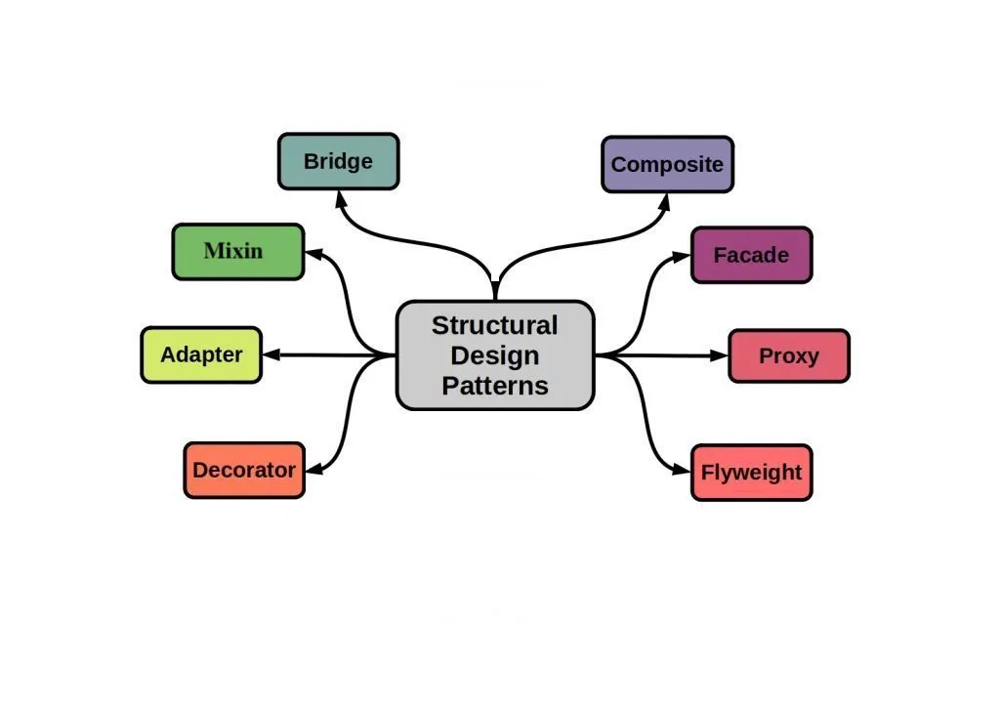

# 2 — Structural Design Patterns



> Structural patterns decide **how classes and objects are put together** to form larger
> structures, while keeping those structures flexible and simple to use.

## 💡 The idea

Creational patterns are about *getting* an object. Structural patterns are about *connecting*
objects that already exist:

- Making two pieces of code **work together** when their interfaces don't match
- Hiding a **complicated subsystem** behind something simple
- **Adding** responsibilities to an object without editing or subclassing it
- **Controlling access** to an object (lazy loading, caching, permissions)
- Treating a **single object** and a **group of objects** the same way

Almost every structural pattern uses the same trick: **wrap one object in another** (or hold a
reference to it) and expose an interface the client actually wants. That is the "favor
composition over inheritance" rule put into practice. You get new structure by *combining*
objects, not by growing deeper class hierarchies.

In SOLID terms, structural patterns protect **OCP** (extend by wrapping, not by editing) and
**ISP/DIP** (clients see the small interface they need, not the messy one underneath).

## Use case

Your checkout code works with your own `PaymentProcessor` interface:
`pay(double amountInDollars)`. Then the business signs a contract with a third-party provider
whose SDK looks completely different: `makeCharge(int amountInCents, String currency)`. You
can't change the SDK because it's not your code. You don't want to rewrite checkout because
it already works.

Without a structural pattern, the conversion code (dollars → cents, add currency, map errors)
leaks into every class that takes a payment. Your code is now **welded** to one vendor's API.

## ❌ Bad example

```java
// Third-party SDK: you can't change it
class StripeClient {
    public void makeCharge(int amountInCents, String currency) {
        System.out.println("Stripe charged " + amountInCents + " " + currency);
    }
}

class CheckoutService {
    private final StripeClient stripe = new StripeClient();

    public void checkout(double amountInDollars) {
        // vendor-specific details leak into business logic
        int cents = (int) Math.round(amountInDollars * 100);
        stripe.makeCharge(cents, "USD");
    }
}

class SubscriptionService {
    private final StripeClient stripe = new StripeClient();

    public void renew(double amountInDollars) {
        // ...and the same conversion is copy-pasted here
        int cents = (int) Math.round(amountInDollars * 100);
        stripe.makeCharge(cents, "USD");
    }
}
```

👉 Problems:

- Business classes know about a vendor SDK and its units
- The same translation code is duplicated in every caller
- Switching provider (or adding a second one) means editing every service
- You can't test checkout without the real SDK class

🔎 SOLID violations:

| Principle | What violates it | Why |
|---|---|---|
| **DIP** | `new StripeClient()` inside `CheckoutService` and `SubscriptionService` | Business logic depends on a concrete vendor SDK instead of on an abstraction it owns |
| **SRP** | The dollars → cents conversion inside `checkout()` and `renew()` | Each service does its own job *and* translates to the vendor's API, so a Stripe change is a reason to edit both |
| **OCP** | Vendor calls spread over every service | Switching or adding a provider means editing every class that takes a payment |

The fix below gives the business code a `PaymentProcessor` abstraction and moves the
translation into one adapter class.

## ✅ Good example

```java
interface PaymentProcessor {
    void pay(double amountInDollars);
}

// The wrapper: translates our interface into the vendor's
class StripePaymentAdapter implements PaymentProcessor {
    private final StripeClient stripe;

    public StripePaymentAdapter(StripeClient stripe) {
        this.stripe = stripe;
    }

    @Override
    public void pay(double amountInDollars) {
        int cents = (int) Math.round(amountInDollars * 100);
        stripe.makeCharge(cents, "USD");
    }
}

class CheckoutService {
    private final PaymentProcessor processor;

    public CheckoutService(PaymentProcessor processor) {
        this.processor = processor;
    }

    public void checkout(double amountInDollars) {
        processor.pay(amountInDollars);
    }
}
```

👉 The incompatibility is solved **once**, inside one wrapper. Business code sees only the
interface it wants, and a new provider is just another wrapper.

This particular wrapper is the **Adapter** pattern. The other structural patterns use the same
wrap-and-delegate idea for different goals: simplifying (Facade), extending (Decorator),
guarding (Proxy), and so on.

## How to spot that you need a structural pattern

- You need a class you can't change (third-party, legacy) to fit an interface you already use
- Clients call 6 different subsystem classes in a precise order just to do one thing
- You're about to create subclasses like `LoggedCachedCompressedFileStream`: a class explosion
  for every combination of features
- An object is expensive to create or remote, and clients shouldn't have to care
- You write `if (node instanceof Folder) ... else ...` to handle trees of items
- Thousands of near-identical objects are eating memory
- An abstraction and its implementation both vary, and inheritance forces you to multiply
  them (`RedCircle`, `BlueCircle`, `RedSquare`, `BlueSquare`, ...)

## Patterns in this family

| # | Pattern | In one sentence | The pain it removes | Status |
|---|---|---|---|---|
| 1 | **Adapter** | Convert one interface into another that clients expect | Incompatible APIs (third-party, legacy) leaking into your code | 🚧 coming soon |
| 2 | **Facade** | Provide one simple entry point to a complex subsystem | Clients orchestrating many low-level classes themselves | 🚧 coming soon |
| 3 | **Decorator** | Add behavior to an object dynamically by wrapping it | Subclass explosion for every feature combination | 🚧 coming soon |
| 4 | [**Proxy**](./4-PROXY/) | Stand in for another object to control access to it | Lazy loading, caching, security checks mixed into real logic | ✅ available |
| 5 | **Composite** | Treat individual objects and groups of them uniformly | Type checks to handle trees (files/folders, menus, UI) | 🚧 coming soon |
| 6 | **Bridge** | Split an abstraction from its implementation so both can vary | Class hierarchies multiplying along two dimensions | 🚧 coming soon |
| 7 | **Flyweight** | Share common state between many fine-grained objects | Memory blow-up from thousands of near-duplicate objects | 🚧 coming soon |
| 8 | **Mixin** | Add reusable behavior to unrelated classes without a common base class | Copy-pasting the same helper methods across hierarchies | 🚧 coming soon |

> **Same shape, different intent.** Adapter, Decorator, and Proxy can look almost identical in
> code: a class wrapping another class. What tells them apart is *why* the wrapper exists:
> Adapter **changes** the interface, Decorator **adds** behavior while keeping it, Proxy
> **controls access** while keeping it. Learn the intent, not the shape.
>
> Mixin is not one of the original "Gang of Four" patterns. Java has no multiple inheritance of
> classes, so in this repo it is shown with `default` methods on interfaces.

## Common misconceptions

- **"A Facade hides the subsystem completely."** It doesn't have to. It offers a simple
  default path, and advanced clients can still use the subsystem directly.
- **"Decorator is just inheritance."** The opposite. Decorators are stacked **at runtime**, in
  any order and combination, which inheritance can't do without a class for every combination.
- **"Adapter means my design is bad."** No. Adapters are the clean, honest way to deal with
  code you don't own.

## Real-world mapping

- `Arrays.asList(...)`, `InputStreamReader` (bytes → characters): Adapter
- `BufferedInputStream(new FileInputStream(...))`, `Collections.synchronizedList(...)`:
  Decorator
- Spring AOP / `@Transactional`, Hibernate lazy-loaded entities, `java.lang.reflect.Proxy`:
  Proxy
- `javax.swing` containers holding components, file systems: Composite
- JDBC (`DriverManager` API separated from vendor drivers): Bridge
- `Integer.valueOf(...)` cache, the `String` pool: Flyweight
- `SLF4J`, a simple logging API over many logging backends: Facade

## Start learning

### [4. Proxy →](./4-PROXY/)

## Next

### [3. Behavioral Patterns →](../3-BEHAVIORAL-PATTERNS/)
