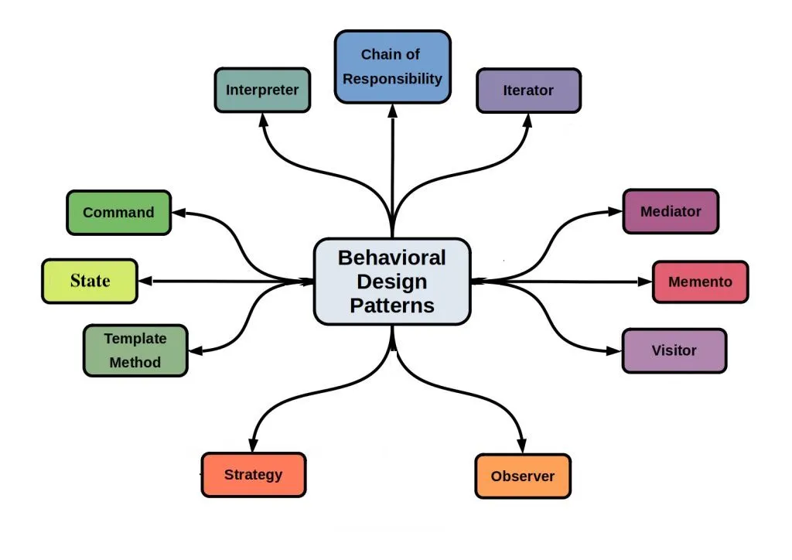

# 3 — Behavioral Design Patterns



> Behavioral patterns decide **how objects communicate and share responsibilities**: who does
> the work, who decides, and who gets told when something happens.

## 💡 The idea

Once objects are created (creational) and assembled (structural), they have to *work
together*. That is where most real-world complexity lives:

- An algorithm that must be **swappable** at runtime (pricing, sorting, routing)
- An object whose behavior depends on its **current state** (an order: new → paid → shipped)
- One event that **many** other parts of the system must react to
- A request that should pass through a **series of handlers** (auth → validation → logging)
- An action that must be **queued, logged, or undone**

Without patterns, this logic turns into giant `if`/`switch` blocks and objects that call each
other directly in a tangled web. Behavioral patterns pull each varying behavior or
communication path into **its own object**, so senders don't have to know receivers and
algorithms don't have to know their callers.

In SOLID terms, behavioral patterns are mostly **OCP** (new behavior = new class, not an edited
`switch`) and **SRP** (each object owns one piece of behavior), held together by **DIP** (talk
to interfaces, not to concrete collaborators).

## Use case

When an order is placed, several things must happen: update inventory, send a confirmation
email, and record an analytics event. Next month, product wants a loyalty-points service and a
Slack alert for big orders.

If `OrderService` calls each of those directly, it has to know about every one of them, and
it changes every time someone *else* wants to react to an order. The class that places orders
has become the class that coordinates half the company.

## ❌ Bad example

```java
class OrderService {
    private final InventoryService inventory = new InventoryService();
    private final EmailService email = new EmailService();
    private final AnalyticsService analytics = new AnalyticsService();

    public void placeOrder(Order order) {
        System.out.println("Order placed: " + order.id());

        // OrderService knows, and calls, every interested party
        inventory.reserve(order);
        email.sendConfirmation(order);
        analytics.track(order);
        // loyalty points? Slack alerts? -> edit this method again
    }
}
```

👉 Problems:

- `OrderService` is tightly coupled to every class that cares about orders
- Every new reaction means editing (and re-testing) the core order logic
- One failing reaction (analytics is down) can break placing the order
- Impossible to enable/disable reactions at runtime or in tests

🔎 SOLID violations:

| Principle | What violates it | Why |
|---|---|---|
| **OCP** | The list of calls inside `placeOrder()` | Every new reaction (loyalty points, Slack) means editing a method that already worked |
| **SRP** | `OrderService` places orders *and* coordinates inventory, email, and analytics | It changes whenever any other team wants to react to an order |
| **DIP** | The `new InventoryService()`, `new EmailService()`, `new AnalyticsService()` fields | The core order logic depends on concrete collaborators instead of on an abstraction |

The fix below makes `OrderService` depend on one small `OrderListener` interface, so new
reactions are new classes, not edits.

## ✅ Good example

```java
interface OrderListener {
    void onOrderPlaced(Order order);
}

class OrderService {
    private final List<OrderListener> listeners = new ArrayList<>();

    public void subscribe(OrderListener listener) {
        listeners.add(listener);
    }

    public void placeOrder(Order order) {
        System.out.println("Order placed: " + order.id());

        // announce the event; whoever cares will react
        for (OrderListener listener : listeners) {
            listener.onOrderPlaced(order);
        }
    }
}

class InventoryListener implements OrderListener {
    public void onOrderPlaced(Order order) { /* reserve stock */ }
}

class EmailListener implements OrderListener {
    public void onOrderPlaced(Order order) { /* send confirmation */ }
}
```

```java
OrderService orders = new OrderService();
orders.subscribe(new InventoryListener());
orders.subscribe(new EmailListener());
orders.subscribe(order -> System.out.println("Analytics: " + order.id()));
```

👉 `OrderService` only announces *what happened*. It doesn't know who listens. Loyalty points
or Slack alerts are a new listener, with zero changes to order logic.

This is the **Observer** pattern. The rest of the family applies the same move, putting
behavior and communication into dedicated objects, to other recurring problems.

## How to spot that you need a behavioral pattern

- A long `if`/`switch` picks *which algorithm* to run, and it keeps growing → **Strategy**
- The same `if (status == ...)` checks appear in every method of a class → **State**
- One class calls a growing list of "interested" classes after something happens →
  **Observer**
- A request goes through a fixed series of nested checks, and the order keeps changing →
  **Chain of Responsibility**
- You need undo/redo, a history, or a queue of actions → **Command** / **Memento**
- Several algorithms share the same skeleton but differ in a few steps → **Template Method**
- Many objects talk to many others and every change ripples everywhere → **Mediator**
- You keep adding new operations (export, validate, price) to a stable class hierarchy →
  **Visitor**

## Patterns in this family

| # | Pattern | In one sentence | The pain it removes | Status |
|---|---|---|---|---|
| 1 | **Strategy** | Make a family of algorithms interchangeable | Growing `if`/`switch` blocks choosing an algorithm | 🚧 coming soon |
| 2 | **Template Method** | Define an algorithm's skeleton and let subclasses fill in steps | Near-identical algorithms copy-pasted with tiny differences | 🚧 coming soon |
| 3 | **Observer** | Notify many dependents automatically when something changes | A subject hard-wired to every class that reacts to it | 🚧 coming soon |
| 4 | **Command** | Turn a request into an object | No way to queue, log, retry, or undo actions | 🚧 coming soon |
| 5 | **State** | Let an object change behavior when its internal state changes | `if (status == ...)` duplicated across every method | 🚧 coming soon |
| 6 | **Chain of Responsibility** | Pass a request along a chain of handlers until one deals with it | Deeply nested, hard-coded processing pipelines | 🚧 coming soon |
| 7 | **Iterator** | Traverse a collection without exposing its internals | Clients depending on how a collection is stored | 🚧 coming soon |
| 8 | **Mediator** | Centralize complex communication between objects | Many-to-many object dependencies (spaghetti calls) | 🚧 coming soon |
| 9 | **Memento** | Capture and restore an object's state without breaking encapsulation | Undo/snapshots that force fields to become public | 🚧 coming soon |
| 10 | **Visitor** | Add new operations to a class hierarchy without changing it | Editing every class whenever a new operation is needed | 🚧 coming soon |
| 11 | **Interpreter** | Represent and evaluate a simple language or grammar | Ad-hoc parsing of rules, filters, or expressions | 🚧 coming soon |

> **Strategy vs. State:** they have almost the same class diagram. With **Strategy**, the
> *client* picks the algorithm. With **State**, the *object itself* switches behavior as its
> state changes. Again: learn the intent, not the shape.

## Common misconceptions

- **"Strategy is just polymorphism."** Yes, and that's the point. Strategy is polymorphism
  used deliberately to make an algorithm a **pluggable dependency**. In modern Java, a simple
  strategy is often just a lambda (`Comparator`, `Function`).
- **"Observer means events and message brokers."** Those are its large-scale cousins. The
  pattern itself is a plain in-process list of listeners.
- **"Visitor is always overkill."** It is when the class hierarchy changes often. It shines
  when the hierarchy is **stable** and the **operations** keep growing (compilers, ASTs,
  document exporters).

## Real-world mapping

- `Comparator` passed to `List.sort(...)`, Spring's pluggable `PasswordEncoder`: Strategy
- `PropertyChangeListener`, Spring `ApplicationEvent`s, UI click listeners: Observer
- `Runnable` submitted to an `ExecutorService`, undo/redo in editors: Command
- Servlet `Filter` chains, Spring Security's filter chain: Chain of Responsibility
- `java.util.Iterator`, the for-each loop: Iterator
- `AbstractList`, `HttpServlet.service()` calling `doGet()`/`doPost()`: Template Method
- `java.util.regex.Pattern`, Spring Expression Language (SpEL): Interpreter
- `FileVisitor` with `Files.walkFileTree(...)`: Visitor

## Next

### 4. Complete Practice Exercise *(coming soon)*

Back to the [main README](../README.md).
