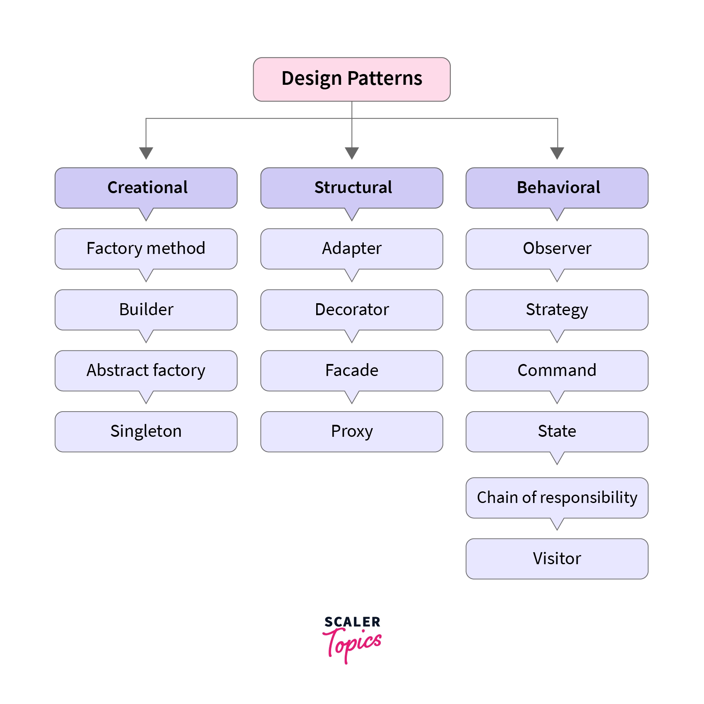

# Design Patterns in Java — Theory, Examples & Exercises

<p align="center">
  
</p>

A structured set of Java exercises on the classic **design patterns**, grouped into the three
families: **Creational**, **Structural**, and **Behavioral**. Each pattern pairs theory with
runnable bad/good examples, clear use cases, and a practice exercise of its own. The course
ends with a Complete Practice Exercise that combines patterns from all three families. It is
for developers who already know OOP and SOLID and want to learn the recurring designs that
experienced engineers reach for.

Part of a broader **Code Quality** track (Code Review, Clean Code, SOLID, Design Patterns).
This repo covers Design Patterns in depth.

## Philosophy

Most design-pattern resources are catalogs: a UML diagram, a definition, a toy example, and
then the next pattern. You finish them able to *name* 23 patterns and unable to tell which one
a real problem needs. Or, worse, you start forcing patterns into code that never needed them.

This repo works the other way around. Every pattern starts from **the pain it removes**. You
see the code that hurts, run it, and feel why it's hard to change. Then you see the pattern
that fixes it, and you practice it on a scenario you haven't seen before.

**A design pattern is not a template to paste. It's a named, proven answer to a problem that
keeps coming back.**

Patterns are SOLID in practice. Almost every pattern here is one or more SOLID principles
applied to a specific, recurring situation:

- Strategy, State, Decorator → **OCP** (add behavior without editing working code)
- Factory Method, Abstract Factory → **DIP** (depend on abstractions, not on `new Concrete()`)
- Facade, Command, Builder → **SRP** (one job per object)
- Adapter → **ISP / DIP** (give clients the interface they actually want)
- Composite, Template Method → **LSP** (subtypes that are truly substitutable)

**Prerequisite: know SOLID first.** If the principles above don't feel natural yet, start with
[solid-principles-java](https://github.com/rusterman/solid-principles-java), the companion repo
this one follows in spirit and structure, then come back here. For OOP fundamentals, see
[cpp-oop-examples-and-exercises](https://github.com/rusterman/cpp-oop-examples-and-exercises).

> **Don't memorize the catalog. Learn to recognize the problem each pattern solves. That's
> what lets you use a pattern when it fits, and skip it when it doesn't.**

## The three families

Every design pattern answers one of three questions:

| Family | The question it answers | Focus |
|---|---|---|
| [**Creational**](./1-CREATIONAL-PATTERNS/) | *How should objects be created?* | Hiding and controlling **object creation** |
| [**Structural**](./2-STRUCTURAL-PATTERNS/) | *How should objects be put together?* | Composing classes and objects into **larger structures** |
| [**Behavioral**](./3-BEHAVIORAL-PATTERNS/) | *How should objects talk to each other?* | Assigning **responsibilities** and **communication** between objects |

A quick way to remember it: **Creational = birth**, **Structural = body**, **Behavioral =
behavior**.

## Learning path

The material is organized progressively. Each family builds on the one before it, and all
three lead to the final, combined exercise.

### [1. Creational Patterns →](./1-CREATIONAL-PATTERNS/)

Take `new` out of your business logic. Factory Method, Abstract Factory, Builder, Prototype,
Singleton, and Multiton, each solving a different "how do I create this?" pain.

### [2. Structural Patterns →](./2-STRUCTURAL-PATTERNS/)

Make incompatible, complex, or expensive objects fit together cleanly. Adapter, Facade,
Decorator, Proxy, Composite, Bridge, Flyweight, and Mixin.

### [3. Behavioral Patterns →](./3-BEHAVIORAL-PATTERNS/)

Distribute responsibilities and decouple who asks from who does. Strategy, Template Method,
Observer, Command, State, Chain of Responsibility, Iterator, Mediator, Memento, Visitor, and
Interpreter.

### 4. Complete Practice Exercise *(coming soon)*

Refactor one realistic system by applying patterns from all three families. You will have to
recognize *which* pattern each problem needs, without being told.

## Repository structure

```
design-patterns-java-examples-and-exercises/
├── README.md                       ← you are here
├── images/
├── 1-CREATIONAL-PATTERNS/
│   ├── README.md                   ← what "creational" really means
│   └── 1-FACTORY-METHOD/           ← one folder per pattern (added progressively)
│       ├── README.md               ← idea, use cases, bad/good example, how to spot it
│       ├── examples/
│       │   ├── 01-bad-example/Main.java
│       │   └── 02-good-example/Main.java
│       └── exercise/
│           ├── README.md           ← scenario, task, acceptance criteria
│           └── Starter.java
├── 2-STRUCTURAL-PATTERNS/
│   └── README.md
└── 3-BEHAVIORAL-PATTERNS/
    └── README.md
```

Every pattern folder follows the same shape, so once you've done one you know how to work
through all of them.

## Setup and requirements

### A Java Development Kit (JDK)

Any JDK 17+ works. Examples use `javac`/`java` directly, with no build tool required.

**macOS**

```bash
brew install openjdk@17
```

**Windows**

Download the installer from [adoptium.net](https://adoptium.net/) and run it, accepting the
defaults.

**Ubuntu / Debian**

```bash
sudo apt update && sudo apt install -y openjdk-17-jdk
```

Verify it worked (any platform):

```bash
java -version
javac -version
```

## Getting started

New to this? Follow these steps **in order**, one command block at a time, top to bottom.

### 1. Install Git

**macOS**

```bash
brew install git
```

**Windows**: download and run [git-scm.com/download/win](https://git-scm.com/download/win),
accepting the defaults.

**Ubuntu / Debian**

```bash
sudo apt update && sudo apt install -y git
```

### 2. Set up Git on your computer

Run this once, ever, on your machine (use the same email as your GitHub account):

```bash
git config --global user.name  "Your Name"
git config --global user.email "you@example.com"
```

### 3. Connect Git to your GitHub account

```bash
brew install gh    # Windows: winget install --id GitHub.cli   |   Linux: sudo apt install gh
gh auth login
```

Answer the prompts: **GitHub.com** → **HTTPS** → **Login with a web browser**. A page opens.
Log in there, then come back to the terminal. You only do this once.

### 4. Fork this repository

Go to [github.com/rusterman/design-patterns-java-examples-and-exercises](https://github.com/rusterman/design-patterns-java-examples-and-exercises)
and click **Fork** (top-right button) → **Create fork**. This makes your own copy, under your
GitHub account, that you're allowed to write to.

### 5. Clone your fork to your computer

Replace `<your-username>` with your GitHub username:

```bash
git clone https://github.com/<your-username>/design-patterns-java-examples-and-exercises.git
cd design-patterns-java-examples-and-exercises
```

### 6. Connect the original repo, so you can pull future updates

New patterns are added over time. Connect the original repo once:

```bash
git remote add upstream https://github.com/rusterman/design-patterns-java-examples-and-exercises.git
```

Then, whenever you want the latest lessons:

```bash
git checkout main
git pull upstream main
git checkout solutions/<your-username>
git merge main
```

### 7. Make your changes, then push them to your fork

Do this every time you finish an exercise:

```bash
git checkout -b solutions/<your-username>   # once, the first time
git add .
git commit -m "exercise: Builder - pizza order"
git push -u origin solutions/<your-username>
```

Your work is now saved on GitHub, in your fork, on a branch named after you.

## How to work through this guide

1. **Go in family order**: `1-CREATIONAL-PATTERNS` → `2-STRUCTURAL-PATTERNS` →
   `3-BEHAVIORAL-PATTERNS` → Complete Practice Exercise.
2. **Read the family's `README.md` first.** It explains what the family is *for* and which
   pain it targets. Every pattern in it is a variation on that one theme.
3. **Then go pattern by pattern, in the order listed.** Read the pattern's `README.md`: the
   idea, the use cases, the bad example, the good example, and how to recognize that a
   problem needs this pattern.
4. **Run both examples.** Don't just read the diff. Compile and execute `01-bad-example` and
   `02-good-example`, then change something and re-run it.
5. **Do the pattern's practice exercise** in `exercise/` before moving on. It is a *new*
   scenario that you solve on your own. No reference solution ships in this repo; see
   [Submitting your solutions](#submitting-your-solutions) below.

### Build & run any example or exercise

```sh
cd 1-CREATIONAL-PATTERNS/1-FACTORY-METHOD/examples/02-good-example
javac Main.java && java Main
```

```sh
cd 1-CREATIONAL-PATTERNS/1-FACTORY-METHOD/exercise
javac Starter.java && java Starter
```

### Rules for learning

- **Don't start from the pattern. Start from the problem.** Run the bad example first and feel
  the pain before you see the fix.
- **Don't memorize UML diagrams.** If you can explain *what changes* and *what stays stable*
  in a design, you already understand the pattern behind it.
- **Don't apply a pattern just because you know it.** Every pattern adds classes and
  indirection. If the pain it removes isn't there, the pattern is over-engineering.
- **Don't skip a pattern's exercise.** The bad/good example shows you *how*; the exercise, on a
  scenario you haven't seen before, tests whether you understand *when*.

## Submitting your solutions

You already set up your `solutions/<your-username>` branch in
[Getting started](#7-make-your-changes-then-push-them-to-your-fork). Push to it every time
you finish an exercise. Commit each exercise separately, with a clear message:

- Per-pattern exercises: `exercise: <PATTERN> - <short description>` (e.g.
  `exercise: Observer - stock price alerts`)
- Complete Practice Exercise stages: `final-exercise: stage <N> - <short description>` (e.g.
  `final-exercise: stage 1 - creational refactor`)

**No answer key ships in this repo.** Every `exercise/` folder is meant to be solved by you.
Any `solution/` or `solutions/` folder is excluded via [`.gitignore`](.gitignore), so it never
reaches GitHub, on this repo or your fork. Once you've genuinely attempted an exercise,
compare notes with a classmate, a code reviewer, or an LLM. Once pushed, you can open a pull
request from `solutions/<your-username>` into your own fork's `main` for a clean, reviewable
diff of your work.

---

The goal isn't to name-drop "Strategy" or "Factory" in an interview. It's to look at a real
piece of code and ask: *what keeps changing here, and how do I isolate it from what doesn't?*
That's the difference between reciting patterns and designing with them.

## Start learning

### [1. Creational Patterns →](./1-CREATIONAL-PATTERNS/)

### [2. Structural Patterns →](./2-STRUCTURAL-PATTERNS/)

### [3. Behavioral Patterns →](./3-BEHAVIORAL-PATTERNS/)

## Contributors

| Contributor | Role |
|---|---|
| [Rustam Atakisiev](https://github.com/rusterman) | Creator & maintainer. Also the author of the companion [solid-principles-java](https://github.com/rusterman/solid-principles-java) and [cpp-oop-examples-and-exercises](https://github.com/rusterman/cpp-oop-examples-and-exercises) repositories |

Want to contribute? Fork the repo, follow the [Submitting your solutions](#submitting-your-solutions)
workflow above, and open a pull request.
